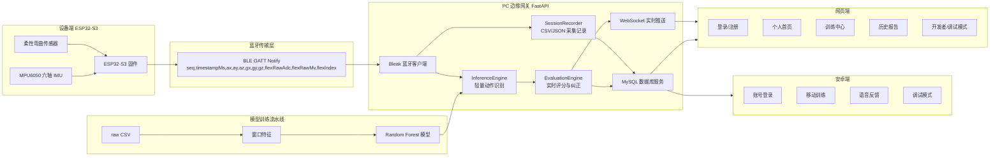
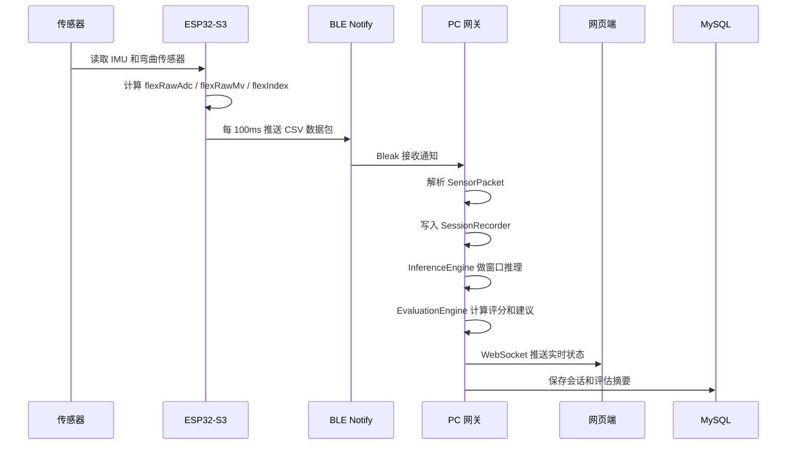
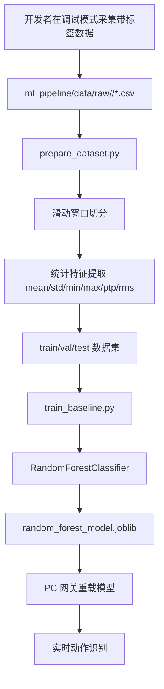
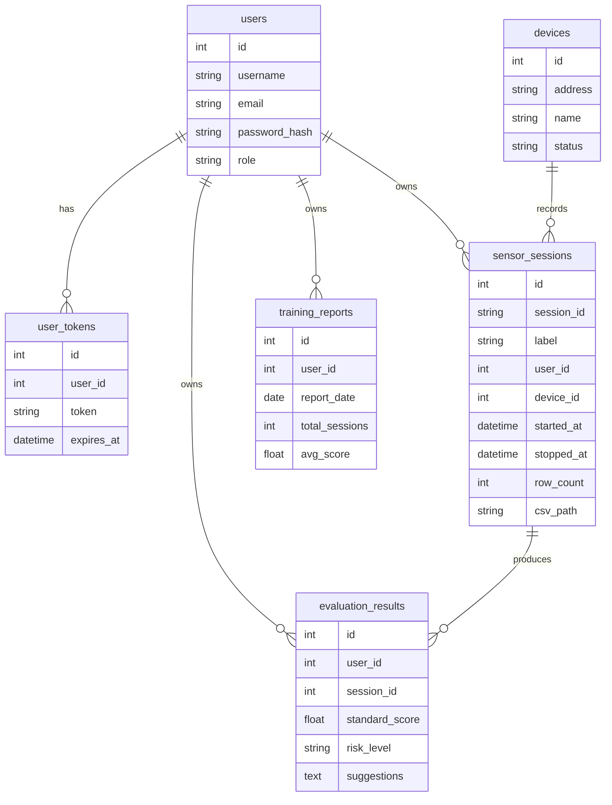

# 智能健身动作矫正系统技术说明与答辩指南

本文档用于项目检查、答辩和代码讲解。它把当前项目从硬件设备、蓝牙传输、PC 网关、网页前端、安卓端、机器学习训练、数据库和训练报告等角度完整串起来，并尽量按老师可能追问的方式解释。

项目名称可以概括为：

> 基于柔性传感与机器学习的智能健身动作矫正系统

一句话介绍：

> 本项目通过 ESP32-S3 采集 IMU 六轴运动数据和柔性弯曲传感器数据，经 BLE 实时传输到手机或 PC 边缘网关，在网关侧完成轻量级动作识别、动作标准度评估、训练记录管理、用户账户管理和报告展示，并提供安卓端移动交互与语音反馈能力。

---

## 1. 总体架构

### 1.1 系统分层

本项目可以分成 5 层：

1. 设备采集层：ESP32-S3、MPU6050、柔性弯曲传感器。
2. 通信传输层：BLE 蓝牙通知 Notify，持续发送传感器数据包。
3. 边缘网关层：Python FastAPI 网关，负责连接设备、记录数据、模型推理、动作评估、数据库读写。
4. 应用展示层：网页端和安卓端，负责用户登录、训练中心、实时反馈、历史报告、开发者调试。
5. 模型训练层：Python 机器学习流水线，负责把 CSV 传感器数据转换成窗口特征，并训练 Random Forest 模型。

### 1.2 架构图



### 1.3 当前实现状态

当前已经实现：

- ESP32-S3 读取 MPU6050 和柔性弯曲传感器。
- 通过 BLE Notify 实时发送 11 字段传感器数据。
- PC 网关扫描、连接、断开 BLE 设备。
- PC 网关把采集数据保存为 CSV 和 JSON 元数据。
- 网页端有登录/注册、个人首页、训练中心、历史报告、开发者调试模式。
- 网页端调试模式支持标签管理、模型训练、模型重载、训练记录管理、传感器数据可视化。
- 使用 scikit-learn Random Forest 训练轻量级动作识别模型。
- MySQL 后端表结构和基础用户系统已经接入。
- 安卓端支持登录、BLE 连接、训练界面、佩戴说明、报告/设置、调试模式和语音反馈框架。

当前半完成或原型性质：

- 动作标准度评分主要是规则引擎和启发式算法，不是严格运动生物力学模型。
- 服务端复杂评估模型目前是框架和规则增强，后续可以替换为更复杂模型。
- 手机端目前更偏本地轻量识别/反馈，不负责训练模型。
- 多动作模型效果取决于后续采集数据质量，卧推等新动作还需要录入标准/错误/静止等样本。

---

## 2. 项目目录总览

项目根目录：

```text
C:\Users\flysusdjd\Documents\New project 3
```

主要目录：

| 目录 | 作用 |
|---|---|
| `ESPS3/` | ESP32-S3 设备端 Arduino 固件代码 |
| `pc_gateway/` | PC 端边缘网关，FastAPI 后端和网页静态前端 |
| `ml_pipeline/` | 机器学习数据准备和模型训练流水线 |
| `esp32s3/` | 安卓 App 项目 |
| `tools/` | 常用 PowerShell 工具脚本 |
| `docs/` | 项目文档、采集协议、MySQL/Navicat 说明、答辩文档 |
| `.arduino-build/` | Arduino 编译生成目录，不属于业务代码 |
| `.arduino-temp/` | Arduino 临时目录，不属于业务代码 |
| `.vscode/` | VS Code 配置 |
| `.git/` | Git 版本控制目录 |
| `【洛迦科技】.../` | 传感器厂商资料或示例资料 |

根目录文件：

| 文件 | 作用 |
|---|---|
| `.env` | 本机环境变量配置，例如 MySQL、端口、路径等 |
| `.env.example` | 环境变量示例模板 |
| `.gitignore` | Git 忽略规则 |

答辩时可以这样说：

> 我的项目不是单一网页，而是一个端到端系统。`ESPS3` 是设备端，`pc_gateway` 是边缘网关和网页，`ml_pipeline` 是模型训练流水线，`esp32s3` 是安卓移动端，`docs` 是项目文档和流程说明。

---

## 3. 数据流逻辑

### 3.1 实时采集数据流



### 3.2 模型训练数据流



### 3.3 用户训练业务流

普通用户理想路径：

```text
登录/注册
-> 个人首页
-> 训练中心
-> 选择训练动作或自动识别
-> 查看佩戴说明
-> 连接设备
-> 开始训练
-> 实时反馈
-> 完成训练并生成报告
-> 历史报告查看趋势
```

开发者路径：

```text
设置
-> 开发者/调试模式
-> 标签管理
-> 采集带标签训练数据
-> 查看 ADC/IMU 原始数据
-> 训练模型
-> 重载模型
-> 管理训练模型记录
```

答辩时要强调：

> 普通用户端尽量隐藏原始 ADC、IMU、模型训练等专业信息，只显示动作识别、次数、评分、纠正建议和历史趋势。开发者调试模式才暴露标签、原始传感器、模型训练和数据管理功能。

---

## 4. 设备端代码说明：`ESPS3/ESPS3.ino`

这是 ESP32-S3 设备端主程序，使用 Arduino 框架开发。

### 4.1 使用技术

| 技术 | 作用 |
|---|---|
| Arduino C++ | ESP32-S3 固件开发 |
| Wire/I2C | 连接 MPU6050 |
| MPU6050 库 | 读取加速度计和陀螺仪 |
| ESP32 BLE | 建立 BLE GATT 服务和 Notify 特征 |
| ADC | 读取柔性弯曲传感器模拟电压 |

### 4.2 硬件配置

固件中的关键配置：

| 配置 | 当前值 | 说明 |
|---|---:|---|
| BLE 设备名 | `ESP32S3_Fitness_BLE` | 手机和 PC 扫描时识别设备 |
| BLE 服务 UUID | `4fafc201-1fb5-459e-8fcc-c5c9c331914b` | GATT 服务 ID |
| BLE 特征 UUID | `beb5483e-36e1-4688-b7f5-ea07361b26a8` | 数据通知特征 ID |
| I2C SDA | GPIO 1 | MPU6050 数据线 |
| I2C SCL | GPIO 2 | MPU6050 时钟线 |
| 柔性传感器 ADC | GPIO 4 | 读取弯曲传感器模拟值 |
| 发送周期 | 100ms | 约 10Hz |

### 4.3 数据包格式

ESP32-S3 每次发送一行 CSV 文本：

```text
seq,timestampMs,ax,ay,az,gx,gy,gz,flexRawAdc,flexRawMv,flexIndex
```

字段含义：

| 字段 | 含义 |
|---|---|
| `seq` | 数据包序号 |
| `timestampMs` | ESP32 上电后的毫秒时间 |
| `ax, ay, az` | MPU6050 三轴加速度原始值 |
| `gx, gy, gz` | MPU6050 三轴陀螺仪原始值 |
| `flexRawAdc` | 柔性传感器 ADC 原始值，范围约 0-4095 |
| `flexRawMv` | 柔性传感器换算后的毫伏值 |
| `flexIndex` | 弯曲指数，经过校准和映射后的 0-100 指标 |

### 4.4 关键函数说明

| 函数 | 作用 |
|---|---|
| `scanI2cDevices()` | 扫描 I2C 总线，帮助确认 MPU6050 是否接线成功 |
| `readFlexVoltageMv()` | 多次采样 ADC，排序后取中间值平均，减少毛刺噪声 |
| `calibrateFlexBaseline()` | 开机时采样自然状态，建立弯曲传感器基线 |
| `calculateBendDeltaMv()` | 根据当前电压和基线计算弯曲变化量 |
| `updateFlexBaseline()` | 当传感器接近自然状态时缓慢更新基线，减少漂移 |
| `calculateFlexIndex()` | 把弯曲变化量映射成 0-100 的弯曲指数 |
| `warnIfFlexOutputNearRail()` | 检查传感器输出是否接近 0 或 3300mV，判断是否饱和 |
| `setupBle()` | 建立 BLE 服务、特征、描述符，并开始广播 |
| `setupMpu()` | 初始化 MPU6050，如果失败则 IMU 数据保持 0，但 BLE 仍可运行 |
| `loop()` | 周期性采集 IMU 和弯曲数据，拼接 CSV，通过串口和 BLE 输出 |

### 4.5 老师可能追问

**问：为什么要把 ADC 转成 flexIndex？**

答：

> ADC 原始值会受到传感器安装松紧、供电、电阻分压和个体差异影响。`flexIndex` 是在开机自然状态基线上做归一化，把“相对弯曲程度”映射到 0-100，更适合前端展示和模型训练。

**问：为什么 MPU6050 连接失败时 BLE 还启动？**

答：

> 这样方便调试。即使 IMU 暂时接线失败，也可以继续看柔性传感器、BLE 连接和网关链路是否正常，避免一个传感器失败导致整个设备不可用。

**问：设备端有没有跑机器学习模型？**

答：

> 目前设备端主要负责采集、预处理和 BLE 传输，机器学习推理主要在 PC 网关侧。后续可以把轻量化模型压缩后部署到 ESP32-S3 或手机端，但当前阶段为了调试和迭代，先把模型放在边缘网关上更方便。

---

## 5. PC 网关目录：`pc_gateway/`

`pc_gateway` 是整个项目的软件中枢。它既是后端 API，又是网页服务器，也是 BLE 网关、模型推理服务和数据库服务。

### 5.1 技术栈

| 技术 | 作用 |
|---|---|
| Python | 后端主语言 |
| FastAPI | HTTP API、WebSocket、静态网页服务 |
| Uvicorn | ASGI 服务器 |
| Bleak | 跨平台 BLE 客户端，连接 ESP32-S3 |
| Pydantic | API 请求和响应数据校验 |
| SQLAlchemy | ORM 数据库访问 |
| PyMySQL | Python 连接 MySQL |
| pandas/numpy | 数据处理和特征计算 |
| scikit-learn | 训练 Random Forest 模型 |
| joblib | 保存和加载模型 |

### 5.2 `pc_gateway/__init__.py`

作用：

- 标记 `pc_gateway` 是 Python 包。
- 允许使用 `python -m pc_gateway` 或在其他模块中进行相对导入。

答辩可以简单说：

> 这是 Python 包初始化文件，本身没有业务逻辑，主要用于模块组织。

### 5.3 `pc_gateway/__main__.py`

作用：

- 作为 `python -m pc_gateway` 的入口。
- 调用 `main.py` 中的 `main()` 函数启动网关。

可以这样说：

> 它是命令行启动入口，真正启动逻辑在 `main.py`。

### 5.4 `pc_gateway/main.py`

核心作用：

- 启动 PC 网关。
- 检查 `pc_gateway.api` 是否可以正确导入。
- 自动选择可用端口，默认从 `8787` 开始。
- 如果端口被占用，会自动切换到下一个端口，例如 `8788`。
- 使用 `uvicorn.run()` 启动 FastAPI。
- 浏览器默认打开登录页。

老师可能问：

**问：为什么之前 8787 被占用会切换 8788？**

答：

> `main.py` 会检测目标端口是否被占用，如果 8787 已经被其他进程占用，会自动寻找下一个可用端口，这样可以避免程序直接启动失败。

**问：为什么会先检查 `pc_gateway.api` 能不能导入？**

答：

> 因为配置文件或 Python 语法错误如果等到 Uvicorn 内部启动才报错，用户不容易定位。提前 import 可以把错误提示聚焦到 `pc_gateway` 代码本身，便于排查。

### 5.5 `pc_gateway/config.py`

核心作用：

- 加载 `.env` 和 `.env.local` 环境变量。
- 统一管理路径、端口、BLE UUID、模型路径、数据库连接配置。

重要配置：

| 配置 | 作用 |
|---|---|
| `RAW_DATA_ROOT` | 原始采集 CSV 保存目录 |
| `PROCESSED_ROOT` | 特征、窗口、标签映射等处理后数据目录 |
| `MODELS_ROOT` | 模型保存目录 |
| `MODEL_PATH` | 当前 Random Forest 模型路径 |
| `LABEL_MAP_PATH` | 标签映射 JSON 路径 |
| `DATASET_META_PATH` | 数据集元信息路径 |
| `BLE_DEVICE_NAME` | 目标 BLE 设备名 |
| `BLE_SERVICE_UUID` | BLE 服务 UUID |
| `BLE_CHARACTERISTIC_UUID` | BLE 数据特征 UUID |
| `RECOMMENDED_LABELS` | 建议采集标签，例如静止、深蹲标准、深蹲错误、卧推标准、卧推错误 |
| `DATABASE_URL` | MySQL 数据库连接字符串 |

老师可能问：

**问：为什么配置单独放一个文件？**

答：

> 这样可以避免路径、端口、UUID、数据库密码散落在不同文件里，修改和部署更方便，也更容易把本地配置和代码逻辑分开。

### 5.6 `pc_gateway/api.py`

这是 FastAPI 应用主文件。

核心职责：

- 创建 `FastAPI` 应用。
- 挂载静态网页目录 `/static`。
- 提供 SPA 页面路由：`/login`、`/dashboard`、`/training`、`/history`、`/debug`。
- 提供 HTTP API。
- 提供 WebSocket 实时推送接口 `/ws/live`。

主要 API 类型：

| 类型 | 示例 | 作用 |
|---|---|---|
| 系统状态 | `/api/status` | 查询设备连接、录制状态、模型状态 |
| BLE 设备 | `/api/devices/scan`、`/api/devices/connect` | 扫描和连接 ESP32-S3 |
| 采集记录 | `/api/recordings/start`、`/api/recordings/stop` | 开始/停止采集 |
| 标签管理 | `/api/labels` | 新增或删除训练标签 |
| 模型管理 | `/api/model/train`、`/api/model/reload` | 训练和重载模型 |
| 认证 | `/api/auth/register`、`/api/auth/login`、`/api/auth/me` | 注册、登录、当前用户 |
| 数据库 | `/api/database/...` | 查询数据库状态、用户、会话、模型等 |
| 报告 | `/api/report/summary` | 获取训练报告汇总 |
| WebSocket | `/ws/live` | 实时推送传感器、识别、评分、建议 |

老师可能问：

**问：为什么网页不是每次刷新去请求，而是用 WebSocket？**

答：

> 传感器数据是连续实时数据。如果用普通 HTTP 轮询，会增加延迟和请求开销。WebSocket 可以由后端主动推送最新状态，更适合实时训练反馈。

### 5.7 `pc_gateway/service.py`

这是后端最重要的业务编排层。

它把以下模块串起来：

| 模块 | 作用 |
|---|---|
| `SessionRecorder` | 保存训练采集 CSV |
| `InferenceEngine` | 加载模型并实时识别动作 |
| `EvaluationEngine` | 根据识别结果和传感器特征给出评分和纠正建议 |
| `AdvancedEvaluationService` | 复杂动作评估框架 |
| `ReportService` | 生成训练报告汇总 |
| `DatabaseService` | MySQL 用户、会话、报告、模型版本管理 |

主要功能：

- 扫描 BLE 设备。
- 连接或断开 ESP32-S3。
- 接收 BLE Notify 数据。
- 解析数据包为 `SensorPacket`。
- 在录制状态下写入 CSV。
- 把最近窗口送入模型推理。
- 把推理结果送入评分引擎。
- 通过 WebSocket 广播给网页。
- 管理标签和训练记录。
- 调用 `prepare_dataset.py` 和 `train_baseline.py` 训练模型。

老师可能问：

**问：为什么要有 `service.py`，不能都写在 `api.py` 里吗？**

答：

> `api.py` 只负责 HTTP 路由，`service.py` 负责业务逻辑。这样路由层更清晰，业务逻辑也可以被 WebSocket、API、后续其他入口复用，代码结构更像真实工程。

### 5.8 `pc_gateway/models.py`

这是网关内部数据模型文件，不是机器学习模型文件。

主要类：

| 类 | 作用 |
|---|---|
| `SensorPacket` | 解析和表示 ESP32 发送的一条传感器数据 |
| `DeviceInfo` | 表示扫描到的 BLE 设备 |
| `RecordingSession` | 表示一次采集会话 |
| `GatewayStatus` | 表示当前网关总体状态 |

`SensorPacket.from_payload()` 会校验数据包字段数量是否为 11，并转换为整数。

老师可能问：

**问：如果 BLE 收到的数据格式错了怎么办？**

答：

> `SensorPacket.from_payload()` 会检查字段数量和类型，不符合格式的数据会被丢弃或记录错误，不会直接进入模型和数据库。

### 5.9 `pc_gateway/recorder.py`

负责训练数据采集。

核心类：

| 类 | 作用 |
|---|---|
| `SessionRecorder` | 管理开始采集、写 CSV、停止采集和保存元数据 |

CSV 保存字段：

```text
recordTimeIso,recordTimeMs,sessionId,label,seq,timestampMs,
ax,ay,az,gx,gy,gz,flexRawAdc,flexRawMv,flexIndex,rawPacket
```

相比设备端 11 字段，网关额外补充：

- 接收时间。
- 采集会话 ID。
- 标签。
- 原始数据包字符串。

保存目录结构：

```text
ml_pipeline/data/raw/<label>/<session_id>.csv
ml_pipeline/data/raw/<label>/<session_id>.json
```

老师可能问：

**问：为什么既保存 CSV 又保存 JSON？**

答：

> CSV 保存每一帧传感器数据，用于训练模型；JSON 保存本次采集的元信息，例如开始时间、结束时间、标签、样本数量，方便前端管理和报告统计。

### 5.10 `pc_gateway/inference.py`

负责模型推理。

核心类：

| 类 | 作用 |
|---|---|
| `InferenceEngine` | 加载 `random_forest_model.joblib`，维护滑动窗口并实时预测动作标签 |

推理流程：

1. 从 BLE 收到一条 `SensorPacket`。
2. 放入最近 N 条数据的缓冲区。
3. 当窗口长度足够时，对窗口提取统计特征。
4. 特征列必须和训练时一致。
5. 使用 Random Forest 预测标签。
6. 如果模型支持 `predict_proba`，输出置信度和前几个候选标签。

特征字段包括：

```text
ax, ay, az, gx, gy, gz, flexIndex
```

统计特征包括：

```text
mean, std, min, max, ptp, rms
```

老师可能问：

**问：为什么不是单条数据直接识别？**

答：

> 人体动作是连续过程，单条数据容易受到噪声和瞬时姿态影响。滑动窗口可以捕捉一小段时间内的变化趋势，比如下蹲、起身、稳定性，比单点判断更可靠。

### 5.11 `pc_gateway/evaluation.py`

负责实时动作评估和纠正建议。

核心类：

| 类 | 作用 |
|---|---|
| `EvaluationEngine` | 根据传感器窗口和推理结果生成动作阶段、标准度评分、风险和语音建议 |

当前评分是启发式规则：

```text
standardScore = 0.40 * depthScore
              + 0.35 * stabilityScore
              + 0.25 * rhythmScore
```

含义：

| 分数 | 含义 |
|---|---|
| `depthScore` | 动作幅度是否足够，例如深蹲深度 |
| `stabilityScore` | 动作是否稳定，例如抖动是否明显 |
| `rhythmScore` | 节奏是否均匀 |
| `standardScore` | 综合标准度评分 |

老师可能问：

**问：标准度评分是机器学习模型算的吗？**

答：

> 当前版本动作类别识别是机器学习模型，标准度评分主要是规则引擎。这样做的好处是可解释性强，适合中期和最终检查展示。后续可以用更多带评分数据训练复杂动作评估模型替换这部分规则。

### 5.12 `pc_gateway/advanced_evaluation.py`

这是更复杂动作评估模型的扩展框架。

核心作用：

- 读取高级评估配置文件。
- 识别代偿风险，例如膝盖内扣、稳定性差、动作幅度不足、节奏不稳。
- 输出更结构化的动作风险和纠正重点。

当前它更像“服务端复杂评估模型”的框架层。

答辩时可以这样说：

> 项目第 4 点提到服务端训练更复杂的动作评估模型，目前我已经在网关中预留了 `AdvancedEvaluationService`，它可以接收实时评估结果并输出代偿风险。当前先用规则阈值实现，后续可以把它替换成更复杂的模型。

### 5.13 `pc_gateway/reporting.py`

负责生成训练报告总览。

主要统计：

- 总会话数。
- 总时长。
- 总行数。
- 标签覆盖率。
- 每个标签的样本数量。
- 最近训练记录。
- 近期趋势。
- 模型准确率和评估指标。

老师可能问：

**问：报告是从哪里来的？**

答：

> 当前报告综合了本地采集记录、模型训练指标和数据库中的会话/评估结果。短期可以基于本地 CSV/JSON 生成，接入 MySQL 后可以按用户查询长期训练趋势。

### 5.14 `pc_gateway/db.py`

数据库连接管理。

核心类：

| 类 | 作用 |
|---|---|
| `DatabaseManager` | 创建 SQLAlchemy Engine、SessionFactory，提供健康检查和建表 |

特点：

- 如果 `.env` 中没有启用 MySQL，系统核心训练和 BLE 功能仍可运行。
- 使用 `session_scope()` 管理事务，成功提交，失败回滚。

老师可能问：

**问：数据库挂了项目还能不能用？**

答：

> 可以部分使用。采集、模型推理、CSV 保存仍然可用，但用户系统、历史报告持久化和数据库查询功能会受影响。这是为了保证硬件调试和模型采集不被数据库强依赖阻断。

### 5.15 `pc_gateway/db_models.py`

这是 MySQL ORM 表结构定义。

主要表：

| 表 | 作用 |
|---|---|
| `users` | 用户账号 |
| `user_tokens` | 登录令牌 |
| `devices` | 设备信息 |
| `sensor_sessions` | 传感器采集会话 |
| `model_versions` | 模型版本记录 |
| `evaluation_results` | 动作评估结果 |
| `training_reports` | 训练报告 |

关键字段：

| 表 | 关键字段 |
|---|---|
| `users` | `username`, `email`, `password_hash`, `role` |
| `sensor_sessions` | `session_id`, `label`, `started_at`, `stopped_at`, `row_count`, `csv_path` |
| `model_versions` | `model_name`, `labels`, `accuracy`, `model_path`, `is_active` |
| `evaluation_results` | `standard_score`, `risk_level`, `suggestions`, `voice_feedback` |
| `training_reports` | `total_sessions`, `total_duration_seconds`, `avg_score`, `report_json` |

老师可能问：

**问：为什么网页只注册用户名密码，表里还有 email？**

答：

> 当前产品设计为了降低使用门槛，只让用户输入用户名和密码。数据库中的 email 字段是为了后续扩展预留，现在可以生成本地占位邮箱，例如 `username@local.smart-fitness`。

### 5.16 `pc_gateway/db_service.py`

数据库业务服务层。

主要职责：

- 注册用户。
- 登录并生成 token。
- 根据 token 获取当前用户。
- 保存设备、采集会话、评估结果、模型版本和训练报告。
- 查询用户首页统计。
- 提供数据库状态和列表数据给调试模式。

重要设计：

- `safe_*` 系列方法在数据库异常时不会让整个网关崩溃。
- 登录密码不会明文保存，而是保存哈希。

老师可能问：

**问：用户密码怎么存？安全吗？**

答：

> 密码通过 `security.py` 使用 PBKDF2-HMAC-SHA256 加随机盐哈希后保存，不存明文。当前是本地项目原型，生产环境还需要 HTTPS、权限控制和更完整的安全策略。

### 5.17 `pc_gateway/security.py`

认证安全工具。

功能：

- `hash_password()`：对密码加盐并哈希。
- `verify_password()`：验证密码。
- `generate_token()`：生成登录 token。

使用技术：

| 技术 | 作用 |
|---|---|
| PBKDF2-HMAC-SHA256 | 密码哈希 |
| `secrets.token_urlsafe` | 生成安全随机 token |
| `hmac.compare_digest` | 防止简单时序攻击 |

### 5.18 `pc_gateway/schemas.py`

普通 API 的 Pydantic 模型。

包括：

- BLE 连接请求。
- 录制开始请求。
- 标签创建请求。
- 模型训练请求。
- 从模型移除标签请求。

作用：

> 统一校验前端传来的 JSON，避免空标签、非法窗口大小、非法步长等错误进入业务层。

### 5.19 `pc_gateway/db_schemas.py`

数据库相关 API 的 Pydantic 模型。

包括：

- 注册请求。
- 登录请求。
- 当前用户响应。
- 用户、设备、会话、评估结果、模型版本、报告的响应结构。

作用：

> 保证数据库接口返回的数据结构稳定，方便网页端和安卓端共用同一套账号系统。

### 5.20 `pc_gateway/static/index.html`

网页端单页应用 HTML。

页面结构：

| 路由 | 页面 |
|---|---|
| `/login` | 登录/注册页 |
| `/dashboard` | 用户个人首页 |
| `/training` | 训练中心 |
| `/history` | 历史报告 |
| `/debug` | 开发者/调试模式 |

特点：

- 一个 HTML 文件承载多个页面。
- 通过前端路由控制显示不同模块。
- 普通用户主要使用 `dashboard/training/history`。
- 开发者功能集中在 `debug`。

### 5.21 `pc_gateway/static/app.js`

网页端核心逻辑。

主要职责：

- 管理 SPA 路由。
- 注册、登录、退出登录。
- 保存 token。
- 调用后端 API。
- 打开 WebSocket。
- 扫描和连接 BLE 设备。
- 开始/结束用户训练。
- 开始/结束开发者标签采集。
- 绘制实时传感器可视化图表。
- 显示动作识别、次数、标准度、纠正建议。
- 调试模式中管理标签、训练记录、模型训练。

重要概念：

| 概念 | 说明 |
|---|---|
| 用户训练 | 面向普通用户，强调开始训练、实时反馈、报告 |
| 开发者采集 | 面向模型维护，需要选择标签并保存训练样本 |
| 标签 | 机器学习训练用类别，例如 `idle`、`squat_standard` |
| 训练动作 | 用户看到的动作，例如深蹲、卧推 |
| WebSocket 状态 | 后端持续推送最新传感器和识别结果 |

老师可能问：

**问：训练中心和调试模式区别是什么？**

答：

> 训练中心是用户产品功能，用户不需要理解标签和模型训练；调试模式是开发者功能，用于采集带标签数据、训练模型、查看原始传感器和维护记录。

### 5.22 `pc_gateway/static/styles.css`

网页样式文件。

负责：

- 登录页设计。
- 左侧导航和顶部状态。
- 个人首页卡片布局。
- 训练中心实时反馈。
- 历史报告。
- 调试模式。
- 响应式布局。
- 颜色、圆角、阴影、运动健康风格。

当前设计方向：

- 活力橙作为主色。
- 健康绿表示标准度和连接状态。
- 调试模式与用户端视觉上区分。
- 尽量减少普通用户看到原始技术数据。

---

## 6. 机器学习目录：`ml_pipeline/`

这是模型训练流水线。

### 6.1 目录结构

```text
ml_pipeline/
  prepare_dataset.py
  train_baseline.py
  requirements.txt
  README.md
  data/
    raw/
    processed/
    splits/
    models/
    model_backups/
```

| 目录 | 作用 |
|---|---|
| `data/raw/` | 原始采集 CSV，按标签分文件夹 |
| `data/processed/` | 滑动窗口、特征、标签映射 |
| `data/splits/` | 训练集、验证集、测试集 |
| `data/models/` | 训练好的模型和指标 |
| `data/model_backups/` | 模型备份 |

### 6.2 `ml_pipeline/prepare_dataset.py`

负责把原始 CSV 转换成机器学习可以训练的表格特征。

输入：

```text
ml_pipeline/data/raw/<label>/*.csv
```

要求 CSV 至少包含：

```text
label,seq,timestampMs,ax,ay,az,gx,gy,gz,flexIndex
```

处理过程：

1. 读取每个标签文件夹下的 CSV。
2. 按窗口大小切分连续传感器数据。
3. 对每个窗口提取统计特征。
4. 按源文件划分训练集、验证集、测试集，减少数据泄漏。
5. 输出特征表、窗口表、标签映射和数据集元信息。

输出：

| 输出文件 | 作用 |
|---|---|
| `data/processed/windows/windows.csv` | 每个窗口的原始窗口信息 |
| `data/processed/features/features.csv` | 每个窗口的统计特征 |
| `data/processed/labels/label_map.json` | 标签到编号的映射 |
| `data/processed/labels/dataset_meta.json` | 数据集元信息 |
| `data/splits/train.csv` | 训练集 |
| `data/splits/val.csv` | 验证集 |
| `data/splits/test.csv` | 测试集 |

老师可能问：

**问：为什么要按源文件划分，而不是随机按行划分？**

答：

> 如果同一次采集的数据同时出现在训练集和测试集，模型会记住那次采集的模式，测试准确率会虚高。按源文件划分可以减少这种数据泄漏，更接近真实泛化能力。

### 6.3 `ml_pipeline/train_baseline.py`

负责训练基础分类模型。

当前模型：

```text
RandomForestClassifier
```

训练流程：

1. 读取 `train.csv`、`val.csv`、`test.csv`。
2. 去掉标签、源文件、窗口索引等非特征列。
3. 使用统计特征训练随机森林。
4. 在验证集和测试集上评估。
5. 保存模型和指标。

输出：

| 输出文件 | 作用 |
|---|---|
| `data/models/random_forest_model.joblib` | 训练好的模型 |
| `data/models/metrics.json` | 准确率、分类报告、混淆矩阵等指标 |

老师可能问：

**问：这是机器学习吗？**

答：

> 是机器学习，但不是深度学习，也不是神经网络大模型。它是传统机器学习中的随机森林分类器，通过已标注的动作数据学习不同动作的统计特征模式。

**问：为什么不用深度学习？**

答：

> 目前数据量较小、传感器数量有限、标签类别还在扩展。随机森林对小数据更友好，训练快、解释性更强、部署成本低。等后续采集更多动作和更多用户数据后，再考虑 LSTM、CNN 或 Transformer 等深度学习模型更合适。

### 6.4 `ml_pipeline/requirements.txt`

记录机器学习环境依赖。

常见依赖：

- `numpy`
- `pandas`
- `scikit-learn`
- `joblib`

### 6.5 `ml_pipeline/README.md`

用于说明机器学习流水线如何运行。

一般训练命令：

```powershell
python ml_pipeline/prepare_dataset.py --window-size 20 --step-size 5
python ml_pipeline/train_baseline.py
```

项目中也提供了 PowerShell 脚本封装，见 `tools/prepare-dataset.ps1` 和 `tools/train-baseline.ps1`。

---

## 7. 安卓端目录：`esp32s3/`

安卓端是手机用户界面。它可以登录同一个 PC 后端，也可以直接通过 BLE 连接设备。

### 7.1 安卓技术栈

| 技术 | 作用 |
|---|---|
| Java | 安卓主开发语言 |
| Android SDK | 原生安卓应用 |
| Material Components / Material3 | UI 风格 |
| BLE GATT | 手机直接连接 ESP32-S3 |
| SharedPreferences | 保存登录状态、后端地址、语音开关 |
| HttpURLConnection | 调用 PC 网关登录/注册 API |
| TextToSpeech | 语音播报 |

### 7.2 `esp32s3/app/src/main/AndroidManifest.xml`

安卓清单文件。

主要作用：

- 声明应用权限。
- 声明 Activity。
- 允许访问局域网 HTTP 后端。
- 声明 BLE 和定位相关权限。

关键权限：

| 权限 | 作用 |
|---|---|
| `BLUETOOTH` | 旧版本蓝牙 |
| `BLUETOOTH_ADMIN` | 旧版本蓝牙管理 |
| `BLUETOOTH_SCAN` | Android 12+ 扫描 BLE |
| `BLUETOOTH_CONNECT` | Android 12+ 连接 BLE |
| `ACCESS_FINE_LOCATION` | BLE 扫描兼容要求 |
| `INTERNET` | 连接 PC 后端 |

关键配置：

```text
android:usesCleartextTraffic="true"
```

解释：

> 因为本地 PC 网关使用的是 `http://192.168.x.x:8787`，不是 HTTPS，所以安卓需要允许明文 HTTP 流量。正式上线应改为 HTTPS。

### 7.3 `AuthActivity.java`

手机登录/注册页。

功能：

- 输入后端地址。
- 输入用户名和密码。
- 注册账号。
- 登录账号。
- 游客浏览。
- 保存登录状态。
- 如果已经登录过，自动进入主界面。

和网页账户互通的原因：

> 安卓端和网页端都调用同一个 PC 网关的 `/api/auth/register` 和 `/api/auth/login`，后端数据库也是同一个 MySQL，所以账号可以互通。

### 7.4 `BackendApiClient.java`

安卓端访问后端 API 的客户端。

功能：

- 发送注册请求。
- 发送登录请求。
- 获取当前用户信息。
- 解析 JSON 响应。
- 把错误信息转成用户可理解的提示。

老师可能问：

**问：手机和电脑账号怎么同步？**

答：

> 它们不是本地各存一份账号，而是都请求同一个 PC 网关后端，后端再写入同一个 MySQL 数据库。因此只要手机和电脑连的是同一个网关地址，就能共用账户。

### 7.5 `SessionManager.java`

手机端会话管理。

保存内容：

- 后端地址。
- token。
- token 过期时间。
- 用户名。
- 游客模式。
- 语音开关。

还会规范化后端地址：

如果用户输入：

```text
http://192.168.1.10:8787/dashboard
```

它会自动转成：

```text
http://192.168.1.10:8787
```

避免接口路径拼接错误。

### 7.6 `MainActivity.java`

安卓主界面逻辑。

主要功能：

- 首页。
- 训练页。
- 佩戴说明。
- 报告页。
- 设置页。
- 调试模式。
- BLE 扫描。
- BLE 连接。
- 启用 Notify。
- 解析 ESP32-S3 的 11 字段数据包。
- 显示实时动作、次数、评分和建议。
- 保存本地 CSV 采集文件。
- TextToSpeech 语音播报。

安卓端和 PC 网关的区别：

| 项目 | PC 网关 | 安卓端 |
|---|---|---|
| 模型训练 | 支持 | 不支持 |
| MySQL 管理 | 支持 | 通过后端间接使用 |
| BLE 连接 | 支持 | 支持 |
| 实时反馈 | 支持 | 支持 |
| 原始数据调试 | 开发者模式 | 设置里的调试模式 |
| 语音反馈 | 不提供用户侧语音开关，显示文字纠正建议 | Android TextToSpeech |

老师可能问：

**问：手机端现在有没有训练模型？**

答：

> 没有。手机端主要是轻量级识别和实时反馈界面，模型训练放在 PC 网关/服务端。这样手机端更轻，普通用户也不需要接触训练标签和模型维护。

### 7.7 `activity_auth.xml`

安卓登录/注册页面布局。

包含：

- Logo 和系统标题。
- 后端地址输入框。
- 用户名输入框。
- 密码输入框。
- 注册按钮。
- 登录按钮。
- 游客浏览按钮。

### 7.8 `activity_main.xml`

安卓主页面布局。

包含：

- 首页模块。
- 训练中心模块。
- 佩戴指导模块。
- 历史报告模块。
- 设置模块。
- 调试模式模块。
- 底部导航栏。

### 7.9 `strings.xml`

安卓文案集中管理。

作用：

- 页面标题。
- 按钮文字。
- 状态提示。
- 语音播报文字。
- 佩戴说明文字。

这样做便于统一修改中文文案。

### 7.10 `colors.xml`

安卓颜色配置。

作用：

- 统一橙色、绿色、背景色、文字色。
- 保持安卓端和网页端风格一致。

### 7.11 `themes.xml` 和 `values-night/themes.xml`

安卓主题配置。

作用：

- 设置 Material 风格。
- 控制状态栏、导航栏和页面主题。
- `values-night` 是夜间模式配置。

### 7.12 `drawable/*.xml`

这些文件是安卓 UI 形状资源，不是业务代码。

常见文件作用：

| 文件 | 作用 |
|---|---|
| `app_background.xml` | 应用背景 |
| `hero_surface.xml` | 首页大卡片背景 |
| `panel_surface.xml` | 普通面板卡片背景 |
| `metric_surface.xml` | 指标卡片背景 |
| `bottom_nav_surface.xml` | 底部导航背景 |
| `auth_orange_badge.xml` | 登录页橙色标识 |
| `auth_chip_green.xml` | 绿色标签 |
| `auth_chip_orange.xml` | 橙色标签 |
| `debug_surface.xml` | 调试模式卡片背景 |
| `live_feedback_surface.xml` | 实时反馈卡片背景 |
| `step_number_surface.xml` | 步骤编号圆形背景 |
| `workflow_step_surface.xml` | 流程步骤背景 |
| `nav_button_bg.xml` | 导航按钮选中状态背景 |

### 7.13 `mipmap-*`

安卓启动图标资源。

答辩时不用展开讲，只要说：

> 这些是 Android Studio 自动生成或维护的应用图标资源。

---

## 8. 工具脚本目录：`tools/`

这些脚本是为了减少手动命令输入。

| 文件 | 作用 |
|---|---|
| `tools/arduino-cli.ps1` | 调用 Arduino CLI 的统一入口 |
| `tools/compile-esp32.ps1` | 编译 ESP32-S3 固件 |
| `tools/upload-esp32.ps1` | 上传固件到指定串口 |
| `tools/list-boards.ps1` | 列出已连接开发板 |
| `tools/install-gateway-deps.ps1` | 安装 PC 网关 Python 依赖 |
| `tools/run-gateway.ps1` | 启动 PC 网关 |
| `tools/prepare-dataset.ps1` | 运行数据准备脚本 |
| `tools/train-baseline.ps1` | 运行模型训练脚本 |
| `tools/README.md` | 工具脚本说明 |

常用操作：

```powershell
powershell -ExecutionPolicy Bypass -File .\tools\run-gateway.ps1
powershell -ExecutionPolicy Bypass -File .\tools\prepare-dataset.ps1
powershell -ExecutionPolicy Bypass -File .\tools\train-baseline.ps1
```

---

## 9. 文档目录：`docs/`

已有文档：

| 文件 | 作用 |
|---|---|
| `01_DOCUMENT_INDEX.md` | 技术文档总目录和阅读顺序 |
| `02_FINAL_CHECK_DEMO_SCRIPT.md` | 最终检查演示脚本 |
| `03_TEACHER_QA_CHEATSHEET.md` | 老师追问速查表 |
| `04_PROJECT_TECHNICAL_DEFENSE_GUIDE.md` | 当前这份完整技术答辩文档 |
| `05_PYTHON_FILES_DETAILED_GUIDE.md` | Python 文件详细说明 |
| `06_FRONTEND_FILES_DETAILED_GUIDE.md` | 网页和安卓前端文件详细说明 |
| `07_DATA_COLLECTION_PROTOCOL.md` | 数据采集规范 |
| `08_FIRST_COLLECTION_PLAN.md` | 首次采集计划 |
| `09_ML_PIPELINE_README.md` | 机器学习流水线说明 |
| `10_PC_GATEWAY_README.md` | PC 网关启动和使用说明 |
| `11_TOOLS_README.md` | 工具脚本说明 |
| `12_MYSQL_BACKEND_SETUP.md` | MySQL 后端接入说明 |
| `13_NAVICAT_MYSQL_SETUP.md` | Navicat 连接 MySQL 说明 |
| `14_MIDTERM_FRAMEWORK_PLAN.md` | 中期框架计划 |

答辩时可以说：

> 我把采集协议、数据库接入、Navicat 操作、代码说明和整体技术答辩说明都放在 `docs/technical_docs` 目录中，并加了数字前缀，按名称排序后就是推荐复习顺序，方便后续维护和检查。

---

## 10. 数据库设计

### 10.1 为什么用 MySQL

本项目使用 MySQL 的原因：

- Navicat 支持好，便于可视化查看数据。
- 关系型表结构适合用户、设备、会话、报告这类结构化数据。
- 对毕业设计来说展示效果清晰。
- 后续可以平滑迁移到云服务器。

### 10.2 数据库表之间的关系



### 10.3 MySQL 在项目中的作用

| 功能 | 是否依赖数据库 |
|---|---|
| 注册登录 | 依赖 |
| 用户个人首页长期统计 | 依赖 |
| 多设备绑定 | 依赖 |
| 历史报告 | 依赖 |
| 原始 CSV 训练 | 不完全依赖，主要依赖本地 CSV |
| 实时 BLE 推理 | 不依赖 |
| 模型训练 | 不依赖数据库，依赖本地 CSV |

老师可能问：

**问：模型数据到底存在数据库还是 CSV？**

答：

> 当前训练模型的数据主体存在 CSV 中，因为机器学习训练读取时更方便、更可追溯。数据库保存会话索引、用户归属、评估结果和报告。也就是说 CSV 保存原始大数据，MySQL 保存结构化业务记录。

---

## 11. 机器学习原理

### 11.1 这是哪类机器学习

当前项目使用的是：

```text
传统监督式机器学习分类
```

具体模型：

```text
Random Forest 随机森林分类器
```

不是：

- 深度学习。
- 神经网络。
- 大模型。
- 强化学习。

### 11.2 为什么适合当前项目

原因：

1. 数据量还不大。
2. 动作类别目前较少。
3. 传感器数量有限。
4. 随机森林对小数据和表格特征表现稳定。
5. 训练速度快，便于现场修改和演示。
6. 特征重要性和分类报告更容易解释。

### 11.3 特征怎么来

传感器原始数据：

```text
ax, ay, az, gx, gy, gz, flexIndex
```

按时间窗口切分后，每个窗口提取：

```text
mean, std, min, max, ptp, rms
```

例如：

```text
ax_mean, ax_std, ax_min, ax_max, ax_ptp, ax_rms
flexIndex_mean, flexIndex_std, flexIndex_min, flexIndex_max, flexIndex_ptp, flexIndex_rms
```

解释：

- `mean`：平均姿态或平均弯曲程度。
- `std`：波动程度。
- `min/max`：动作范围。
- `ptp`：峰峰值，反映变化幅度。
- `rms`：能量强度，反映运动剧烈程度。

### 11.4 训练标签

目前标签设计包括：

| 标签 | 含义 |
|---|---|
| `idle` | 静止 |
| `squat_standard` | 标准深蹲 |
| `squat_wrong` | 错误深蹲 |
| `bench_standard` | 标准卧推 |
| `bench_wrong` | 错误卧推 |

前端显示可翻译成：

| 内部标签 | 中文显示 |
|---|---|
| `idle` | 静止 |
| `squat_standard` | 深蹲-标准 |
| `squat_wrong` | 深蹲-错误 |
| `bench_standard` | 卧推-标准 |
| `bench_wrong` | 卧推-错误 |

### 11.5 为什么静止可能识别成深蹲

常见原因：

1. 模型训练时没有包含足够 `idle` 样本。
2. `idle` 和动作样本数量不平衡。
3. 传感器佩戴姿态和训练数据不同。
4. 当前模型只知道训练过的类别，会强制从已有类别中选一个。
5. 新动作加入后没有重新训练或没有重载模型。

正确回答：

> 分类模型只能在训练过的标签中选择最像的类别。如果静止样本不足或当前佩戴方式变化，模型可能把静止误判成深蹲。解决方法是补充同一佩戴方式下的静止样本、保证每个标签样本数量相对均衡，然后重新训练并重载模型。

---

## 12. 网页端页面逻辑

### 12.1 登录/注册页

功能：

- 用户名密码注册。
- 用户名密码登录。
- 游客浏览。
- 登录后进入个人首页。

设计原因：

> 普通用户不需要先看到调试数据，登录后直接进入个人首页，更像真实健身平台。

### 12.2 个人首页 `/dashboard`

显示：

- 今日训练时长。
- 今日消耗热量估算。
- 本周标准度。
- 最近训练记录。
- 训练反馈。
- 开始训练入口。

注意：

> 首页不显示原始 ADC、IMU、十六进制包等专业数据，避免用户困惑。

### 12.3 训练中心 `/training`

显示：

- 当前动作识别。
- 累计次数。
- 标准度评分。
- 实时纠正建议。
- 动作质量指标。
- 设备连接状态。
- 佩戴说明。

训练中心面向普通用户，按钮文案应该是：

- `开始训练`
- `完成训练并生成报告`

而不是：

- `开始本组采集`
- `选择训练标签`

### 12.4 历史报告 `/history`

显示：

- 最近训练记录。
- 标准度趋势。
- 与上次训练对比。
- 风险统计。
- 训练次数和时长。

当前更多是报告框架和本地/数据库汇总，后续可以进一步接入更完整的 MySQL 用户历史。

### 12.5 开发者/调试模式 `/debug`

调试模式面向开发者和答辩展示。

功能：

- 数据库状态。
- 模型状态。
- 标签管理。
- 从模型移除标签。
- 删除标签。
- 开发者带标签采集。
- 训练模型。
- 重载模型。
- 训练模型记录管理。
- 弯曲传感器可视化。
- IMU 六轴数据可视化。
- 原始数据包查看。

答辩时可以说：

> 我把专业数据和开发者功能统一放入调试模式，普通用户页面只保留训练体验相关内容。

---

## 13. 手机端页面逻辑

### 13.1 手机端定位

手机端定位：

> 移动端显示实时动作数据、标准度评分和纠正建议，并提供语音反馈。

它不承担完整模型训练任务。

### 13.2 手机和网页账号是否互通

是互通的，前提是：

- 手机和电脑在同一个局域网。
- 手机后端地址填写电脑网关地址，例如 `http://192.168.x.x:8787`。
- PC 网关和 MySQL 正常运行。

原理：

> 手机端和网页端都调用同一个 FastAPI 后端的认证接口，后端写入同一个 MySQL 数据库。

### 13.3 手机端为什么可能连不上

常见原因：

1. 手机填成了 `127.0.0.1`。手机里的 `127.0.0.1` 指手机自己，不是电脑。
2. 电脑和手机不在同一网络。
3. 电脑防火墙阻止 8787 端口。
4. PC 网关只绑定了 `127.0.0.1`，没有绑定 `0.0.0.0`。
5. 填成了 `https://`，但后端是 `http://`，会出现 TLS 报文解析错误。
6. 电脑开了代理，导致局域网连接异常。

`unable to parse tls packet header` 的含义：

> 客户端把一个普通 HTTP 服务当成 HTTPS 去访问，或者代理把流量协议弄错了。解决方法是确认地址是 `http://电脑局域网IP:8787`，不要写 `https://`。

---

## 14. 语音反馈逻辑

### 14.1 网页端反馈

网页端当前不提供用户侧语音播报开关。

原因：

- PC 网页更适合展示训练可视化、报告和开发者调试。
- 用户训练时不一定盯着电脑屏幕，语音提示更适合手机端或后续设备端。
- 网页端保留文字纠正建议、标准度评分、动作质量指标和训练次数。

### 14.2 安卓端语音

安卓端使用 `TextToSpeech`。

要求：

- 手机系统安装并启用文字转语音引擎。
- 推荐安装 `Speech Services by Google`。
- 设置里选择可用 TTS 引擎。
- App 中开启语音开关。

当前语音播报内容来自实时纠正建议，例如：

- 保持稳定。
- 下蹲深度不够。
- 动作节奏放慢。
- 膝盖方向保持稳定。

老师可能问：

**问：语音反馈是怎么触发的？**

答：

> 动作评估模块会生成 `voiceFeedback` 文案。当前网页端把纠正建议作为文字展示；安卓端在语音开关开启时调用 TextToSpeech 播报，并设置冷却时间，避免同一句话连续重复播报。

---

## 15. 关键功能如何使用

### 15.1 启动 PC 网关

```powershell
powershell -ExecutionPolicy Bypass -File .\tools\run-gateway.ps1
```

浏览器打开：

```text
http://127.0.0.1:8787/login
```

如果 8787 被占用，会自动切换到 8788。

### 15.2 普通用户训练流程

1. 打开登录页。
2. 注册或登录账号。
3. 进入个人首页。
4. 点击开始训练。
5. 查看佩戴说明。
6. 扫描设备。
7. 连接 ESP32-S3。
8. 点击开始训练。
9. 完成动作。
10. 点击完成训练并生成报告。
11. 到历史报告查看记录和趋势。

### 15.3 开发者采集标签数据

1. 进入调试模式。
2. 在标签管理中确认标签，例如 `bench_standard`。
3. 连接设备。
4. 选择采集标签。
5. 开始开发者采集。
6. 做对应动作。
7. 停止采集。
8. 在训练模型记录中确认新记录。

### 15.4 训练模型

网页方式：

1. 进入调试模式。
2. 勾选要训练的标签。
3. 设置窗口大小，例如 20。
4. 设置步长，例如 5。
5. 点击训练模型。
6. 训练成功后自动重载模型，或手动点击重载模型。

命令行方式：

```powershell
powershell -ExecutionPolicy Bypass -File .\tools\prepare-dataset.ps1
powershell -ExecutionPolicy Bypass -File .\tools\train-baseline.ps1
```

### 15.5 安卓端使用

1. 确保电脑和手机在同一局域网。
2. PC 网关启动。
3. 查看电脑局域网 IP。
4. 手机后端地址填写 `http://电脑IP:8787`。
5. 登录同一账号。
6. 扫描并连接 ESP32-S3。
7. 开始训练。
8. 开启语音反馈。

---

## 16. 老师可能刁难的问题与回答

### 16.1 这是机器学习还是简单阈值判断？

答：

> 动作类别识别部分是机器学习，使用 Random Forest 监督分类模型。传感器数据会按滑动窗口提取统计特征，然后模型输出动作类别。动作标准度评分部分当前主要是规则引擎，用于给出可解释的纠正建议，所以这是“机器学习分类 + 规则评估”的组合。

### 16.2 为什么不用神经网络？

答：

> 当前数据集规模较小，动作种类还在扩展，使用神经网络容易过拟合，训练和部署成本也更高。随机森林适合小规模表格特征，训练快、效果稳定、容易解释。后续如果采集到更多动作和更多用户数据，可以升级到 LSTM 或 CNN 处理时间序列。

### 16.3 你的模型准确率可信吗？

答：

> 我在数据准备时按采集文件划分训练集、验证集和测试集，尽量避免同一次采集同时出现在训练和测试中造成数据泄漏。但目前数据量仍有限，所以准确率只能说明当前采集条件下的效果，后续需要更多用户、更多姿态和更多场景验证泛化能力。

### 16.4 只有一个传感器，怎么判断动作标准不标准？

答：

> 当前一个设备主要用于识别动作类别和基础动作质量趋势，例如动作幅度、节奏和稳定性。它不能完全替代多传感器或视觉系统的全身姿态分析。后续可以增加多个 IMU 或更多柔性传感器，分别贴在膝关节、髋部、肘部等位置，提高对代偿动作的判断能力。

### 16.5 深蹲和卧推佩戴位置不一样，模型会不会受影响？

答：

> 会受影响。所以每个动作的数据采集必须保持佩戴位置和方向一致。深蹲可以贴在膝关节附近，卧推更适合放在手臂或肘关节附近。模型学习的是“传感器在固定位置时的动作模式”，所以佩戴规范是模型可靠性的前提。

### 16.6 用户为什么不选择标签？

答：

> 普通用户不应该理解训练标签。标签是开发者采集训练数据时使用的。用户只需要开始训练，系统根据模型自动识别动作并给出反馈。这样产品逻辑更清晰，也更像真实健身 App。

### 16.7 训练中心开始训练和调试模式模型训练有什么区别？

答：

> 训练中心的“开始训练”是普通用户的一次健身训练，会用于实时反馈和报告；调试模式的“训练模型”是开发者用已采集的带标签 CSV 数据重新训练机器学习模型。一个是用户行为，一个是模型维护行为。

### 16.8 删除标签和从模型移除标签有什么区别？

答：

> 删除标签是删除项目中这个标签的配置或对应采集标签入口；从模型移除标签是重新训练模型时不再使用该标签的数据，让模型不再预测这个类别。删除标签不等于自动删除已经训练好的模型，因为模型文件是训练结果，需要重新训练才会改变类别范围。

### 16.9 为什么静止会识别成深蹲？

答：

> 机器学习模型只能在训练过的类别中选择一个。如果静止数据不足、佩戴方式变化，或者模型中静止类别不平衡，就可能误判。解决方法是补采当前佩戴方式下的静止数据，保证每个类别样本数量接近，然后重新训练并重载模型。

### 16.10 标准度评分是不是科学准确？

答：

> 当前标准度评分是原型阶段的可解释评分，综合动作幅度、稳定性和节奏。它适合项目演示和趋势反馈，但不是医疗级或运动康复级评估。后续可以通过专家标注数据训练更复杂的动作评估模型，提高准确性。

### 16.11 你的服务端、设备端、边缘网关分别是什么？

答：

> 设备端是 ESP32-S3，它直接连接传感器并通过 BLE 发数据。边缘网关是 PC 上的 FastAPI 程序，它连接 BLE、保存数据、运行模型、给网页推送结果。服务端在当前阶段主要由 PC 网关承担，包括数据库、模型管理和报告生成；如果部署到云服务器，服务端可以独立出来负责用户数据和复杂模型训练。

### 16.12 手机端是不是设备端？

答：

> 严格来说手机端是移动应用端，不是传感器设备端。设备端是 ESP32-S3。手机可以作为边缘端的一种，直接连接 BLE 并做轻量反馈，但它不等同于传感器设备。

### 16.13 为什么用 BLE 而不是 Wi-Fi？

答：

> BLE 功耗低、适合穿戴设备、手机兼容性好，而且传感器数据包比较小，10Hz 左右的数据量用 BLE Notify 足够。Wi-Fi 带宽更高，但功耗和配网复杂度更高。

### 16.14 为什么要 MySQL？

答：

> CSV 适合保存原始传感器序列，MySQL 适合保存结构化业务数据，例如用户、设备、训练会话、模型版本、评估结果和报告。两者结合可以兼顾模型训练和用户系统。

### 16.15 你现在符合项目七点目标吗？

答：

> 大体已经形成端到端原型。第一点硬件集成已经完成基本设计；第二点 BLE 传输已经实现；第三点轻量级动作识别在 PC 网关实现，手机端有轻量反馈框架；第四点复杂动作评估模型目前是规则和扩展框架；第五点设备端部署轻量评估还未完全完成，目前更多在网关和手机端；第六点移动端和网页端显示实时数据、评分和建议已实现；第七点个人训练报告和趋势已经有基础框架，后续需要更多真实数据完善。

---

## 17. 当前完成度对照

### 17.1 已完成

- ESP32-S3 固件采集 IMU 和柔性传感器。
- BLE Notify 数据发送。
- PC 网关扫描和连接设备。
- CSV/JSON 训练数据保存。
- 网页登录注册。
- 网页个人首页。
- 网页训练中心。
- 网页历史报告框架。
- 网页开发者调试模式。
- 标签管理。
- 训练记录管理。
- 传感器数据可视化。
- Random Forest 训练脚本。
- 模型加载和实时推理。
- 规则评分和纠正建议。
- MySQL 用户、会话、报告等表结构。
- 安卓登录、训练、佩戴说明、设置和调试界面。

### 17.2 半完成

- 卧推模型数据还需要继续采集。
- 手机端语音受系统 TTS 环境影响。
- 手机端轻量识别还偏规则，未完全接入 PC 训练模型。
- 历史报告趋势需要更多真实训练数据支撑。
- 高级动作评估模型目前是规则框架。

### 17.3 未完成或后续优化

- 多传感器融合。
- 云端服务部署。
- 设备端本地模型推理。
- 更严格的动作标准度标注数据集。
- 更专业的热量估算，需要体重、性别、年龄、MET 值。
- 多用户真实长期训练数据。
- HTTPS 和生产级安全认证。

---

## 18. 代码文件总表

### 18.1 ESP32 固件

| 文件 | 作用 |
|---|---|
| `ESPS3/ESPS3.ino` | 设备端主程序，读取 MPU6050 和柔性传感器，通过 BLE 发送数据 |

### 18.2 PC 网关 Python

| 文件 | 作用 |
|---|---|
| `pc_gateway/__init__.py` | Python 包初始化 |
| `pc_gateway/__main__.py` | `python -m pc_gateway` 启动入口 |
| `pc_gateway/main.py` | 启动 Uvicorn、端口选择、导入检查 |
| `pc_gateway/config.py` | 配置、路径、UUID、数据库连接 |
| `pc_gateway/api.py` | FastAPI 路由、WebSocket、静态网页 |
| `pc_gateway/service.py` | 网关业务编排核心 |
| `pc_gateway/models.py` | 传感器包、设备、会话、状态等内部模型 |
| `pc_gateway/recorder.py` | CSV/JSON 采集记录器 |
| `pc_gateway/inference.py` | 加载模型、滑动窗口推理 |
| `pc_gateway/evaluation.py` | 实时评分、动作阶段、纠正建议 |
| `pc_gateway/advanced_evaluation.py` | 高级动作评估和代偿风险框架 |
| `pc_gateway/reporting.py` | 本地训练报告汇总 |
| `pc_gateway/db.py` | SQLAlchemy 数据库连接管理 |
| `pc_gateway/db_models.py` | MySQL ORM 表结构 |
| `pc_gateway/db_service.py` | 用户、设备、会话、报告等数据库业务 |
| `pc_gateway/db_schemas.py` | 数据库 API 请求/响应模型 |
| `pc_gateway/schemas.py` | 普通 API 请求/响应模型 |
| `pc_gateway/security.py` | 密码哈希、token 生成和验证 |

### 18.3 网页前端

| 文件 | 作用 |
|---|---|
| `pc_gateway/static/index.html` | 单页应用 HTML，包含登录、首页、训练、历史、调试页面结构 |
| `pc_gateway/static/app.js` | 前端业务逻辑、路由、API、WebSocket、训练和调试交互 |
| `pc_gateway/static/styles.css` | 网页 UI 样式、响应式布局、卡片和图表样式 |

### 18.4 机器学习

| 文件 | 作用 |
|---|---|
| `ml_pipeline/prepare_dataset.py` | 从原始 CSV 生成窗口特征和数据集切分 |
| `ml_pipeline/train_baseline.py` | 训练 Random Forest 模型并保存指标 |
| `ml_pipeline/requirements.txt` | 机器学习依赖 |
| `ml_pipeline/README.md` | 训练流水线说明 |

### 18.5 安卓 Java

| 文件 | 作用 |
|---|---|
| `esp32s3/app/src/main/java/com/example/esp32s3/AuthActivity.java` | 安卓登录/注册页面 |
| `esp32s3/app/src/main/java/com/example/esp32s3/MainActivity.java` | 安卓主界面、BLE、实时反馈、TTS |
| `esp32s3/app/src/main/java/com/example/esp32s3/BackendApiClient.java` | 安卓访问 PC 后端 API |
| `esp32s3/app/src/main/java/com/example/esp32s3/SessionManager.java` | 安卓登录状态和后端地址保存 |

### 18.6 安卓 XML

| 文件 | 作用 |
|---|---|
| `esp32s3/app/src/main/AndroidManifest.xml` | 权限、Activity、网络配置 |
| `esp32s3/app/src/main/res/layout/activity_auth.xml` | 登录注册页面布局 |
| `esp32s3/app/src/main/res/layout/activity_main.xml` | 安卓主页面布局 |
| `esp32s3/app/src/main/res/values/strings.xml` | 安卓中文文案 |
| `esp32s3/app/src/main/res/values/colors.xml` | 安卓颜色 |
| `esp32s3/app/src/main/res/values/themes.xml` | 安卓主题 |
| `esp32s3/app/src/main/res/values-night/themes.xml` | 夜间主题 |
| `esp32s3/app/src/main/res/drawable/*.xml` | UI 背景、卡片、按钮形状 |
| `esp32s3/app/src/main/res/xml/backup_rules.xml` | Android 备份规则 |
| `esp32s3/app/src/main/res/xml/data_extraction_rules.xml` | Android 数据导出规则 |

### 18.7 工具脚本

| 文件 | 作用 |
|---|---|
| `tools/arduino-cli.ps1` | Arduino CLI 封装 |
| `tools/compile-esp32.ps1` | 编译 ESP32 固件 |
| `tools/upload-esp32.ps1` | 上传 ESP32 固件 |
| `tools/list-boards.ps1` | 查看串口和开发板 |
| `tools/install-gateway-deps.ps1` | 安装 Python 依赖 |
| `tools/run-gateway.ps1` | 启动 PC 网关 |
| `tools/prepare-dataset.ps1` | 准备机器学习数据集 |
| `tools/train-baseline.ps1` | 训练基础模型 |

---

## 19. 答辩时的推荐讲法

### 19.1 30 秒版本

> 我的项目是一个基于柔性弯曲传感器和 IMU 的智能健身动作矫正系统。设备端使用 ESP32-S3 采集六轴运动和弯曲数据，通过 BLE 实时传给 PC 网关或手机端。PC 网关使用 FastAPI 负责设备连接、数据采集、模型推理、动作评分、用户系统和报告展示。模型部分使用传统机器学习 Random Forest，对滑动窗口统计特征进行分类，识别静止、深蹲标准、深蹲错误以及后续卧推动作。网页和安卓端面向普通用户显示训练次数、标准度评分和纠正建议，调试模式则用于开发者采集标签数据和训练模型。

### 19.2 2 分钟版本

> 系统从硬件到软件分为五层。第一层是 ESP32-S3 设备端，连接 MPU6050 和柔性弯曲传感器，采集 `ax, ay, az, gx, gy, gz, flexRawAdc, flexRawMv, flexIndex` 等数据。第二层是 BLE 通信，通过 GATT Notify 每 100ms 推送一条数据。第三层是 PC 边缘网关，使用 FastAPI 和 Bleak 连接设备，接收数据后保存 CSV，同时送入机器学习推理模块和动作评估模块。第四层是应用层，网页端提供登录、个人首页、训练中心、历史报告和调试模式，安卓端提供移动训练、佩戴说明和语音反馈。第五层是机器学习流水线，先用 `prepare_dataset.py` 把原始 CSV 切成滑动窗口并提取统计特征，再用 `train_baseline.py` 训练 Random Forest 模型，最后网关加载模型用于实时识别。
>
> 当前项目的设计重点是把普通用户功能和开发者功能分开。普通用户只看到训练动作、次数、评分和建议；开发者调试模式才看到原始 ADC、IMU、标签采集、模型训练和记录管理。这样既能满足答辩展示，也更接近真实产品逻辑。

### 19.3 如果老师追问“不够高级怎么办”

可以回答：

> 当前阶段我没有盲目使用深度学习，而是根据数据规模选择了随机森林。因为我的数据还在采集阶段，类别数量有限，小数据下传统机器学习更稳定，也更容易解释。系统架构已经预留了高级评估服务和模型版本管理，后续采集更多动作和更多用户后，可以把 `InferenceEngine` 或 `AdvancedEvaluationService` 替换为 LSTM、CNN 或其他时序模型。

---

## 20. 最后检查前建议

后天检查前最关键的是：

1. 保证 ESP32-S3 能被扫描并连接。
2. 保证网页 `/login`、`/dashboard`、`/training`、`/history`、`/debug` 都能打开。
3. 保证至少有一个模型可以被加载。
4. 保证静止和深蹲至少能演示识别或实时数据变化。
5. 如果明天采卧推，先备份旧模型，再采集卧推标准、卧推错误和静止数据。
6. 训练新模型后一定要点击重载模型，并确认调试模式模型状态正常。
7. 准备好解释“当前是原型，不是医疗级标准动作评估”。
8. 准备好解释“普通用户端”和“开发者调试端”的区别。

建议演示顺序：

```text
登录/注册
-> 个人首页
-> 训练中心
-> 扫描连接设备
-> 开始训练看实时反馈
-> 历史报告
-> 设置/调试模式
-> 展示传感器可视化、标签数据、模型训练记录
```

---

## 21. 项目技术关键词

答辩时可以主动提到这些关键词：

- ESP32-S3
- MPU6050
- 柔性弯曲传感器
- ADC
- I2C
- BLE GATT
- Notify
- Edge Gateway
- FastAPI
- WebSocket
- MySQL
- SQLAlchemy
- Pydantic
- scikit-learn
- Random Forest
- Sliding Window
- Feature Extraction
- CSV Dataset
- Model Version
- Android BLE
- TextToSpeech
- 用户端与开发者模式隔离
- 训练报告和长期趋势

---

## 22. 一句话总结优势与不足

优势：

> 项目已经形成从传感器采集、蓝牙传输、边缘网关、机器学习识别、网页/安卓展示、数据库和报告管理的完整闭环。

不足：

> 当前数据量和动作类别还有限，标准度评估仍以规则为主，后续需要更多动作数据、多传感器融合和更复杂模型来提升泛化能力和评估准确性。
