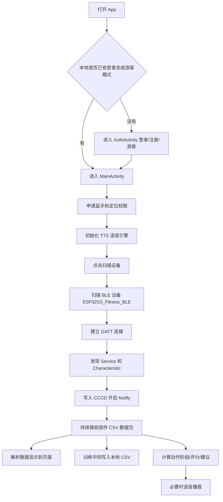
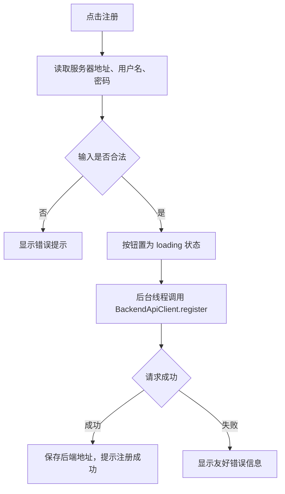
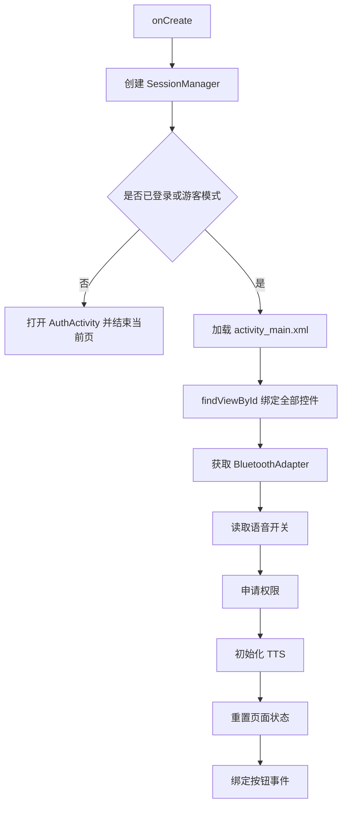
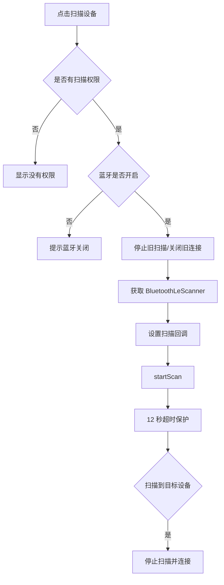
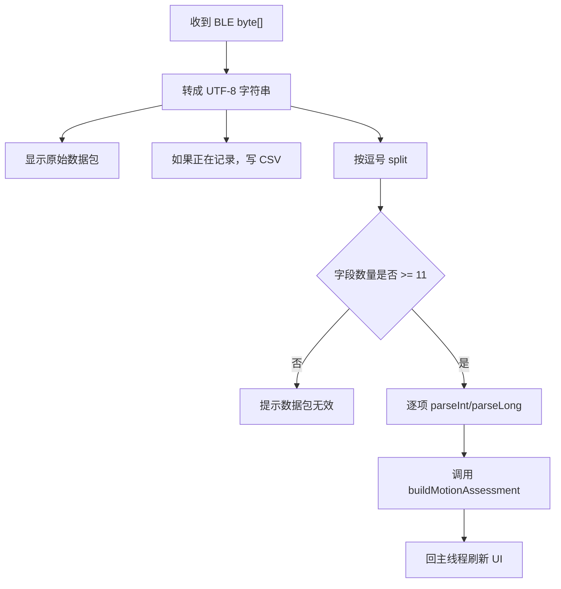
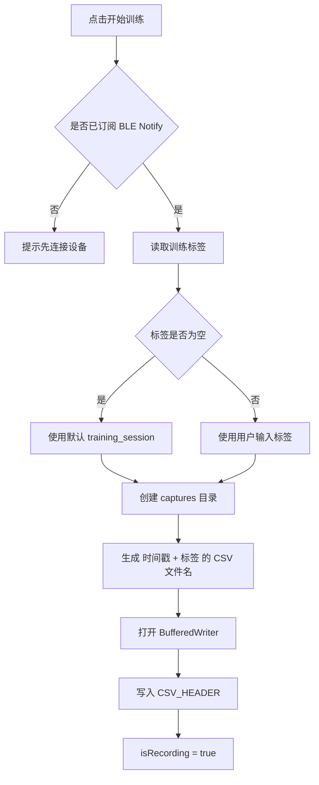
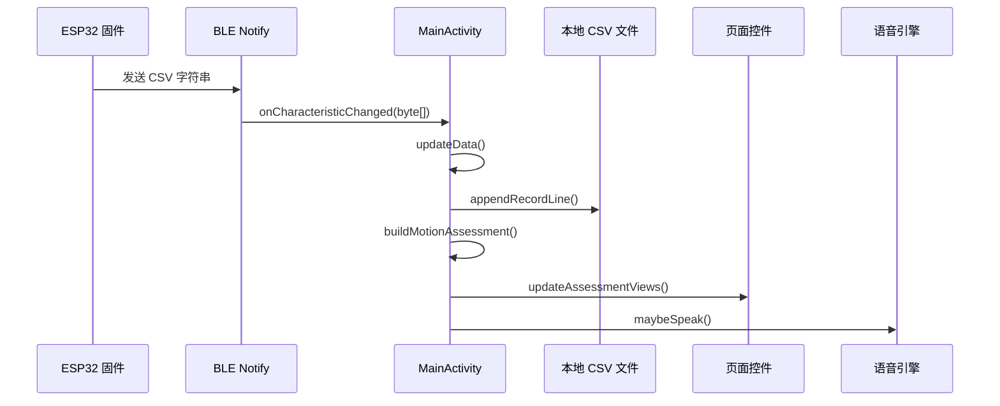

# Android 手机 App 代码详细讲解

本文档用于帮助你从零理解本项目的 Android 手机端代码。它不是简单列文件名，而是按“应用做什么、页面怎么跳转、BLE 怎么连接、数据怎么解析、训练怎么记录、评分怎么计算、语音怎么播报”的顺序，把代码串成一条能读懂的主线。

> 当前 Android 项目路径：`esp32s3/app`
>
> 主要 Java 包名：`com.example.esp32s3`
>
> 主要入口文件：
> - `esp32s3/app/src/main/AndroidManifest.xml`
> - `esp32s3/app/src/main/java/com/example/esp32s3/AuthActivity.java`
> - `esp32s3/app/src/main/java/com/example/esp32s3/MainActivity.java`
> - `esp32s3/app/src/main/java/com/example/esp32s3/BackendApiClient.java`
> - `esp32s3/app/src/main/java/com/example/esp32s3/SessionManager.java`

## 1. 这个手机 App 负责什么

手机端 App 的核心职责可以拆成五件事：

1. 登录或游客进入：通过 `AuthActivity` 让用户填写 PC 网关地址、用户名、密码，也可以游客模式进入。
2. 扫描并连接 ESP32-S3：通过 BLE 搜索设备名为 `ESP32S3_Fitness_BLE` 的设备。
3. 接收实时传感器数据：订阅 BLE Characteristic 的 Notify，接收固件发来的 CSV 字符串。
4. 显示与记录训练数据：把加速度、角速度、弯曲 ADC、电压、弯曲指数显示到页面；训练时写入手机本地 CSV。
5. 本地实时评估：根据弯曲指数和陀螺仪数据估算动作阶段、标准度评分、风险等级、纠正建议，并用 TTS 语音播报。

一句话概括：

> 这个 Android App 是 ESP32 传感器节点的手机训练终端，既能接收 BLE 数据，也能给用户看到训练反馈，还能把训练过程保存为 CSV。

## 2. 整体运行流程



从这张图看，代码主线其实很清楚：

- `AuthActivity` 管登录。
- `SessionManager` 管本地保存的登录状态。
- `MainActivity` 管 BLE、页面、记录、评估、语音。
- `BackendApiClient` 管访问 PC 网关接口。

## 3. Gradle 构建配置

文件：`esp32s3/app/build.gradle.kts`

这个文件告诉 Android Studio / Gradle 这个 App 怎么编译。

关键配置：

```kotlin
android {
    namespace = "com.example.esp32s3"
    compileSdk = 36

    defaultConfig {
        applicationId = "com.example.esp32s3"
        minSdk = 26
        targetSdk = 36
        versionCode = 1
        versionName = "1.0"
    }
}
```

逐项解释：

- `namespace`：代码和资源生成时使用的命名空间。
- `applicationId`：安装到手机上的应用 ID，也就是系统识别这个 App 的唯一包名。
- `compileSdk = 36`：用 Android 36 的 API 来编译。
- `minSdk = 26`：最低支持 Android 8.0。
- `targetSdk = 36`：表示 App 按 Android 36 的行为规则适配。
- `versionCode`：内部版本号，发版时通常递增。
- `versionName`：用户看到的版本名。

依赖部分：

```kotlin
dependencies {
    implementation(libs.appcompat)
    implementation(libs.material)
    implementation(libs.activity)
    implementation(libs.constraintlayout)
}
```

这里用到了：

- AppCompat：兼容旧版本 Android 的基础组件。
- Material：Material Design 控件，本项目登录页输入框使用 `TextInputEditText`。
- Activity：AndroidX Activity 支持库。
- ConstraintLayout：布局库，虽然当前主布局主要用 `LinearLayout`，但项目依赖里保留了它。

## 4. AndroidManifest.xml 讲解

文件：`esp32s3/app/src/main/AndroidManifest.xml`

Manifest 是 Android 应用的“总说明书”，系统启动 App、授权权限、注册页面都靠它。

### 4.1 权限声明

```xml
<uses-permission android:name="android.permission.BLUETOOTH" android:maxSdkVersion="30" />
<uses-permission android:name="android.permission.BLUETOOTH_ADMIN" android:maxSdkVersion="30" />
```

这两项是 Android 11 及以下使用蓝牙需要的老权限。

```xml
<uses-permission android:name="android.permission.BLUETOOTH_SCAN"
    android:usesPermissionFlags="neverForLocation" />
<uses-permission android:name="android.permission.BLUETOOTH_CONNECT" />
```

这两项是 Android 12 及以上新增的蓝牙权限：

- `BLUETOOTH_SCAN`：允许扫描蓝牙设备。
- `BLUETOOTH_CONNECT`：允许连接蓝牙设备、读设备名、操作 GATT。

```xml
<uses-permission android:name="android.permission.ACCESS_FINE_LOCATION" />
<uses-permission android:name="android.permission.ACCESS_COARSE_LOCATION" />
```

很多 Android 设备要求扫描 BLE 时仍然需要定位权限，否则可能扫不到设备。

```xml
<uses-permission android:name="android.permission.INTERNET" />
```

访问 PC 网关的登录、注册接口需要网络权限。

### 4.2 查询 TTS 服务

```xml
<queries>
    <package android:name="com.google.android.tts" />
    <intent>
        <action android:name="android.intent.action.TTS_SERVICE" />
    </intent>
</queries>
```

Android 11 以后，App 不能随便查询手机上安装了什么应用。这里声明 App 需要查询 Google TTS 和系统 TTS 服务，这样 `MainActivity` 才能检测语音引擎是否可用。

### 4.3 application 配置

```xml
<application
    android:allowBackup="true"
    android:icon="@mipmap/ic_launcher"
    android:label="@string/app_name"
    android:theme="@style/Theme.Esp32s3"
    android:usesCleartextTraffic="true">
```

重点是：

- `android:label="@string/app_name"`：桌面显示名称来自 `strings.xml`。
- `android:theme="@style/Theme.Esp32s3"`：应用主题来自 `themes.xml`。
- `android:usesCleartextTraffic="true"`：允许访问 `http://` 地址。因为 PC 网关通常是局域网 `http://电脑IP:8787`，不是 HTTPS，所以必须打开。

### 4.4 Activity 注册

```xml
<activity
    android:name=".AuthActivity"
    android:exported="true">
    <intent-filter>
        <action android:name="android.intent.action.MAIN" />
        <category android:name="android.intent.category.LAUNCHER" />
    </intent-filter>
</activity>
```

`AuthActivity` 是启动页，因为它有：

- `MAIN`：应用主入口。
- `LAUNCHER`：桌面点击图标时启动它。

```xml
<activity
    android:name=".MainActivity"
    android:exported="false" />
```

`MainActivity` 是主训练页面，但不直接暴露给系统外部启动，只由 App 内部跳转进入。

## 5. 页面布局资源

Android 项目把“页面长什么样”写在 XML 里，把“页面怎么动”写在 Java 里。

### 5.1 登录页布局 activity_auth.xml

文件：`esp32s3/app/src/main/res/layout/activity_auth.xml`

这个页面主要包含：

- 服务器地址输入框：`etBackendUrl`
- 用户名输入框：`etAuthUsername`
- 密码输入框：`etAuthPassword`
- 状态文字：`tvAuthStatus`
- 提示文字：`tvAuthHint`
- 注册按钮：`btnRegister`
- 登录按钮：`btnLogin`
- 游客按钮：`btnGuest`

这些 ID 会在 `AuthActivity.onCreate()` 中通过 `findViewById()` 绑定：

```java
etBackendUrl = findViewById(R.id.etBackendUrl);
etUsername = findViewById(R.id.etAuthUsername);
etPassword = findViewById(R.id.etAuthPassword);
tvAuthStatus = findViewById(R.id.tvAuthStatus);
tvAuthHint = findViewById(R.id.tvAuthHint);
btnRegister = findViewById(R.id.btnRegister);
btnLogin = findViewById(R.id.btnLogin);
btnGuest = findViewById(R.id.btnGuest);
```

也就是说：

> XML 里的 `android:id="@+id/xxx"`，最终会变成 Java 里的 `R.id.xxx`。

### 5.2 主页面布局 activity_main.xml

文件：`esp32s3/app/src/main/res/layout/activity_main.xml`

这个主页面是一个单 Activity 多页面结构。它并没有为首页、训练、指导、报告、设置分别创建多个 Activity，而是把这些页面都写在同一个 XML 里，再用 `setVisibility()` 控制显示隐藏。

主要页面容器：

- `pageHome`：首页
- `pageTraining`：训练中心
- `pageGuide`：佩戴说明与动作指导
- `pageReport`：训练记录/报告
- `pageSettings`：设置与调试

底部导航按钮：

- `btnNavHome`
- `btnNavTraining`
- `btnNavGuide`
- `btnNavReport`
- `btnNavSettings`

训练中心核心控件：

- `btnScan`：扫描 BLE 设备
- `btnDisconnect`：断开连接
- `btnStartRecord`：开始训练/记录
- `btnStopRecord`：结束训练
- `btnVoiceToggle`：开关语音提示
- `etActionLabel`：本地记录标签

实时反馈控件：

- `tvEvalAction`：当前动作
- `tvEvalPhase`：动作阶段
- `tvEvalScore`：标准度评分
- `tvEvalRisk`：风险等级
- `tvEvalSuggestion`：纠正建议
- `tvVoiceStatus`：语音状态

调试数据显示控件：

- `tvSequence`：数据包序号
- `tvTimestamp`：固件时间戳
- `tvAcceleration`：加速度
- `tvGyroscope`：角速度
- `tvFlexAdc`：弯曲 ADC
- `tvFlexMv`：弯曲电压
- `tvFlexIndex`：弯曲指数
- `tvRawPacket`：原始 CSV 数据包

## 6. strings.xml 讲解

文件：`esp32s3/app/src/main/res/values/strings.xml`

这个文件集中保存所有中文界面文案。这样做有三个好处：

1. Java 代码不用写一堆硬编码中文。
2. 修改按钮、提示、状态文字时不需要改 Java 逻辑。
3. 后续如果做中英文切换，可以增加其他语言的 `strings.xml`。

例如：

```xml
<string name="btn_scan">扫描设备</string>
<string name="status_scanning">正在扫描设备…</string>
<string name="eval_suggestion_depth">下蹲深度偏浅，建议继续屈膝并保持脚跟稳定。</string>
```

Java 里这样使用：

```java
tvStatus.setText(R.string.status_scanning);
showToast(R.string.btn_scan);
```

带参数的字符串：

```xml
<string name="metric_acc_value">X=%1$d  Y=%2$d  Z=%3$d</string>
```

Java 里这样使用：

```java
tvAcceleration.setText(getString(R.string.metric_acc_value, ax, ay, az));
```

其中：

- `%1$d` 表示第 1 个整数参数。
- `%2$d` 表示第 2 个整数参数。
- `%3$d` 表示第 3 个整数参数。

## 7. AuthActivity.java 详细讲解

文件：`esp32s3/app/src/main/java/com/example/esp32s3/AuthActivity.java`

`AuthActivity` 是 App 打开后的第一屏，负责：

- 判断用户是否已经登录或游客进入。
- 显示服务器地址、用户名、密码输入框。
- 调用 PC 网关注册接口。
- 调用 PC 网关登录接口。
- 进入游客模式。
- 登录成功后跳转到 `MainActivity`。

### 7.1 成员变量

```java
private TextInputEditText etBackendUrl;
private TextInputEditText etUsername;
private TextInputEditText etPassword;
private TextView tvAuthStatus;
private TextView tvAuthHint;
private Button btnRegister;
private Button btnLogin;
private Button btnGuest;
```

这些变量对应登录页布局里的控件。

```java
private SessionManager sessionManager;
private ExecutorService authExecutor;
```

- `SessionManager`：负责保存和读取登录状态。
- `ExecutorService`：后台线程池，用来执行网络请求。

为什么要用后台线程？

> Android 不允许在主线程做网络请求，因为网络请求可能卡住界面。注册、登录都要放到后台线程执行。

### 7.2 onCreate()

`onCreate()` 是 Activity 创建时最先执行的重要方法。

它做了几件事：

1. 创建 `SessionManager`。
2. 如果已经有登录态或游客模式，直接进入主页面。
3. 加载 `activity_auth.xml`。
4. 绑定控件。
5. 创建后台线程池。
6. 恢复之前保存的服务器地址和用户名。
7. 给按钮绑定点击事件。

核心代码逻辑：

```java
sessionManager = new SessionManager(this);
if (sessionManager.hasAccessMode()) {
    openMainActivity();
    return;
}
```

意思是：

- 如果用户已经登录，或者之前选择过游客模式，就不用再次登录。
- 直接打开主页面。

绑定按钮：

```java
btnRegister.setOnClickListener(v -> submitRegister());
btnLogin.setOnClickListener(v -> submitLogin());
btnGuest.setOnClickListener(v -> enterAsGuest());
```

这里使用 Lambda 表达式：

- 点击注册按钮，执行 `submitRegister()`。
- 点击登录按钮，执行 `submitLogin()`。
- 点击游客按钮，执行 `enterAsGuest()`。

### 7.3 submitRegister()

注册流程：



关键代码：

```java
String backendUrl = normalizedBackendUrl();
String username = valueOf(etUsername);
String password = valueOf(etPassword);
```

这三行从输入框取值。

```java
if (!validateInputs(backendUrl, username, password)) {
    return;
}
```

如果用户没填服务器、用户名、密码，就不继续。

```java
authExecutor.execute(() -> {
    try {
        BackendApiClient.RegisterResponse response =
                BackendApiClient.register(backendUrl, username, password);
        runOnUiThread(() -> {
            sessionManager.saveBackendUrl(backendUrl);
            setLoading(false);
            etUsername.setText(response.username);
            tvAuthStatus.setText(R.string.auth_status_register_success);
        });
    } catch (IOException | JSONException e) {
        showAuthError(e.getMessage());
    }
});
```

重点：

- `authExecutor.execute(...)`：放到后台线程执行。
- `BackendApiClient.register(...)`：真正发网络请求。
- `runOnUiThread(...)`：回到主线程更新 UI。

为什么更新 UI 要回主线程？

> Android 的 UI 控件只能在主线程修改。后台线程直接改 TextView/Button 容易崩溃。

### 7.4 submitLogin()

登录流程和注册类似，但登录成功后会保存令牌并进入主页面。

关键代码：

```java
BackendApiClient.LoginResponse response =
        BackendApiClient.login(backendUrl, username, password);
sessionManager.saveLogin(
        backendUrl,
        response.accessToken,
        response.expiresAt,
        response.username
);
```

这里保存了：

- 后端地址
- 访问令牌 `accessToken`
- 令牌过期时间
- 用户名

之后：

```java
openMainActivity();
```

打开主页面。

### 7.5 enterAsGuest()

游客模式不需要用户名密码，只需要服务器地址。

```java
sessionManager.enableGuestMode(backendUrl);
openMainActivity();
```

游客模式保存的是：

- 后端地址
- `guest_mode = true`

同时会清理：

- access token
- token expiry
- username

这样不会出现“明明游客模式，却还带着旧账号令牌”的混乱状态。

### 7.6 validateInputs()

这个函数做输入校验：

```java
if (backendUrl.isEmpty() || !backendUrl.startsWith("http")) {
    tvAuthStatus.setText(R.string.auth_status_invalid_server);
    return false;
}
```

服务器地址必须以 `http` 开头，例如：

```text
http://192.168.1.100:8787
```

用户名和密码不能为空。

### 7.7 toFriendlyAuthMessage()

网络报错通常比较难懂，比如：

- failed to connect
- connect timeout
- not found

这个函数把这些错误转换成中文：

```java
return "无法连接到服务器，请确认手机和电脑连接到同一个 Wi‑Fi 或同一个热点，并检查服务器地址与端口是否正确。";
```

这对用户体验很重要。

## 8. BackendApiClient.java 详细讲解

文件：`esp32s3/app/src/main/java/com/example/esp32s3/BackendApiClient.java`

这个类负责 Android App 和 PC 网关后端之间的 HTTP 通信。

它是一个工具类：

```java
public final class BackendApiClient {
    private BackendApiClient() {
    }
}
```

`private BackendApiClient()` 表示外部不能创建它的对象，只能调用静态方法。

### 8.1 register()

```java
public static RegisterResponse register(String backendUrl, String username, String password)
        throws IOException, JSONException
```

作用：

1. 构造 JSON：

```json
{
  "username": "用户名",
  "password": "密码"
}
```

2. 请求接口：

```text
POST /api/auth/register
```

3. 解析返回的用户信息。

核心代码：

```java
JSONObject body = new JSONObject();
body.put("username", username);
body.put("password", password);
JSONObject payload = executeJsonRequest("POST", backendUrl + "/api/auth/register", body, null);
JSONObject user = payload.getJSONObject("user");
return new RegisterResponse(user.getString("username"));
```

### 8.2 login()

登录请求接口：

```text
POST /api/auth/login
```

登录成功后返回：

- `accessToken`
- `expiresAt`
- `user.username`

代码：

```java
return new LoginResponse(
        payload.getString("accessToken"),
        payload.optString("expiresAt", ""),
        user.getString("username")
);
```

`optString("expiresAt", "")` 的意思是：

- 如果 JSON 里有 `expiresAt`，就取出来。
- 如果没有，就返回空字符串。

### 8.3 getCurrentUser()

```java
public static CurrentUserResponse getCurrentUser(String backendUrl, String accessToken)
```

作用是通过 token 查询当前登录用户：

```text
GET /api/auth/me
Authorization: Bearer token
```

目前 Android 主页面主要使用本地保存的用户名，没有大规模使用这个函数，但它是后续“校验登录态是否过期”的基础。

### 8.4 executeJsonRequest()

这是最重要的底层请求函数。

它统一处理：

- URL 打开
- 请求方法 GET/POST
- 连接超时
- 读取超时
- 请求头
- Authorization
- JSON 请求体
- 响应码
- 错误信息解析

关键代码：

```java
connection.setConnectTimeout(8000);
connection.setReadTimeout(10000);
```

表示：

- 连接服务器最多等 8 秒。
- 服务器响应最多等 10 秒。

请求头：

```java
connection.setRequestProperty("Accept", "application/json");
connection.setRequestProperty("Content-Type", "application/json; charset=UTF-8");
```

告诉后端：

- App 希望收到 JSON。
- App 发出去的数据也是 UTF-8 JSON。

带 token：

```java
connection.setRequestProperty("Authorization", "Bearer " + accessToken.trim());
```

这就是常见的 Bearer Token 认证。

写请求体：

```java
byte[] bytes = body.toString().getBytes(StandardCharsets.UTF_8);
try (OutputStream outputStream = connection.getOutputStream()) {
    outputStream.write(bytes);
    outputStream.flush();
}
```

读取响应：

```java
int statusCode = connection.getResponseCode();
String responseText = readAll(statusCode >= 200 && statusCode < 300
        ? connection.getInputStream()
        : connection.getErrorStream());
```

如果状态码是 200 到 299，说明成功，读正常响应流。

如果不是，说明失败，读错误响应流。

### 8.5 readAll()

这个函数把服务器响应流转成字符串：

```java
while ((line = reader.readLine()) != null) {
    builder.append(line);
}
```

### 8.6 extractErrorMessage()

后端错误一般是：

```json
{
  "detail": "错误原因"
}
```

这个函数优先取 `detail`：

```java
return payload.optString("detail", responseText);
```

如果不是 JSON，就直接返回原始文本。

## 9. SessionManager.java 详细讲解

文件：`esp32s3/app/src/main/java/com/example/esp32s3/SessionManager.java`

这个类负责把用户状态保存到手机本地。

底层使用：

```java
SharedPreferences preferences;
```

`SharedPreferences` 可以理解为 Android 提供的轻量键值数据库，适合保存：

- 用户名
- token
- 开关
- 简单配置

### 9.1 保存了哪些键

```java
private static final String KEY_BACKEND_URL = "backend_url";
private static final String KEY_ACCESS_TOKEN = "access_token";
private static final String KEY_TOKEN_EXPIRY = "token_expiry";
private static final String KEY_USERNAME = "username";
private static final String KEY_GUEST_MODE = "guest_mode";
private static final String KEY_VOICE_ENABLED = "voice_enabled";
```

含义：

- `backend_url`：PC 网关地址。
- `access_token`：登录后的访问令牌。
- `token_expiry`：令牌过期时间。
- `username`：当前用户名。
- `guest_mode`：是否游客模式。
- `voice_enabled`：语音反馈是否开启。

### 9.2 saveLogin()

```java
public void saveLogin(String backendUrl, String accessToken, String tokenExpiry, String username)
```

登录成功后调用它。

它会保存：

```java
.putString(KEY_BACKEND_URL, normalizeBackendUrl(backendUrl))
.putString(KEY_ACCESS_TOKEN, accessToken)
.putString(KEY_TOKEN_EXPIRY, tokenExpiry)
.putString(KEY_USERNAME, username)
.putBoolean(KEY_GUEST_MODE, false)
```

注意游客模式被设置为 `false`，表示当前是正式登录。

### 9.3 enableGuestMode()

游客模式调用它。

```java
.remove(KEY_ACCESS_TOKEN)
.remove(KEY_TOKEN_EXPIRY)
.remove(KEY_USERNAME)
.putBoolean(KEY_GUEST_MODE, true)
```

它会删除登录账号信息，只保留后端地址和游客状态。

### 9.4 clearSession()

退出登录或切换账号时调用：

```java
preferences.edit()
        .remove(KEY_ACCESS_TOKEN)
        .remove(KEY_TOKEN_EXPIRY)
        .putBoolean(KEY_GUEST_MODE, false)
        .apply();
```

它不会删除 `backend_url`，这样用户下次登录时还可以看到上次填写的服务器地址。

### 9.5 hasAccessMode()

```java
public boolean hasAccessMode() {
    return isLoggedIn() || isGuestMode();
}
```

它是 AuthActivity 和 MainActivity 判断“能不能进入主页面”的核心条件。

### 9.6 normalizeBackendUrl()

这个函数很实用。

用户可能输入：

```text
http://192.168.1.100:8787/
http://192.168.1.100:8787/login
http://192.168.1.100:8787/dashboard
```

但接口拼接时需要的是：

```text
http://192.168.1.100:8787
```

所以它会：

1. 去掉末尾 `/`。
2. 去掉 `/login`、`/dashboard`、`/training`、`/history`、`/debug` 等页面路径。

这样 `BackendApiClient` 拼接口时不会变成：

```text
http://192.168.1.100:8787/login/api/auth/login
```

## 10. MainActivity.java 总体讲解

文件：`esp32s3/app/src/main/java/com/example/esp32s3/MainActivity.java`

这是手机 App 最大、最核心的文件。

它负责：

- 显示主页面。
- 管理底部导航。
- 请求蓝牙权限。
- 扫描 ESP32。
- 建立 BLE GATT 连接。
- 订阅数据通知。
- 解析传感器数据。
- 本地保存 CSV。
- 实时评估动作。
- TTS 语音播报。
- 登录/游客状态显示。

可以把它理解成手机端的“总控制器”。

## 11. MainActivity 的重要常量

### 11.1 BLE 相关常量

```java
private static final String DEVICE_NAME = "ESP32S3_Fitness_BLE";
private static final UUID SERVICE_UUID = UUID.fromString("4fafc201-1fb5-459e-8fcc-c5c9c331914b");
private static final UUID CHAR_UUID = UUID.fromString("beb5483e-36e1-4688-b7f5-ea07361b26a8");
private static final UUID CCCD_UUID = UUID.fromString("00002902-0000-1000-8000-00805f9b34fb");
```

这些值必须和 ESP32 固件一致。

- `DEVICE_NAME`：手机扫描时找的设备名。
- `SERVICE_UUID`：ESP32 BLE 服务 UUID。
- `CHAR_UUID`：ESP32 用来发送数据的特征值 UUID。
- `CCCD_UUID`：标准的通知开关描述符 UUID。

BLE 通知要开启，必须写 CCCD。

### 11.2 连接与语音常量

```java
private static final int REQUEST_MTU = 247;
private static final long SCAN_TIMEOUT_MS = 12000L;
private static final long VOICE_COOLDOWN_MS = 2800L;
private static final long TTS_INIT_SETTLE_MS = 300L;
```

含义：

- `REQUEST_MTU = 247`：请求更大的 BLE 单包传输大小。
- `SCAN_TIMEOUT_MS = 12000L`：扫描最多 12 秒。
- `VOICE_COOLDOWN_MS = 2800L`：同一句语音提示 2.8 秒内不重复播。
- `TTS_INIT_SETTLE_MS = 300L`：TTS 初始化后等 300ms 再完成配置。

### 11.3 CSV 表头

```java
private static final String CSV_HEADER =
        "phoneReceiveTimeMs,label,seq,timestampMs,ax,ay,az,gx,gy,gz,flexRawAdc,flexRawMv,flexIndex,rawPacket";
```

训练记录文件第一行就是这个表头。

字段解释：

- `phoneReceiveTimeMs`：手机收到数据的时间。
- `label`：训练标签。
- `seq`：ESP32 数据包序号。
- `timestampMs`：ESP32 开机后的毫秒时间。
- `ax, ay, az`：三轴加速度。
- `gx, gy, gz`：三轴角速度。
- `flexRawAdc`：弯曲传感器 ADC 原始值。
- `flexRawMv`：弯曲传感器电压。
- `flexIndex`：固件计算出的弯曲指数，0 到 100。
- `rawPacket`：原始 CSV 数据包，方便后续核对。

## 12. MainActivity 的成员变量

### 12.1 UI 控件变量

这些变量都来自 `activity_main.xml`：

```java
private TextView tvStatus;
private TextView tvEvalScore;
private Button btnScan;
private Button btnStartRecord;
private TextInputEditText etActionLabel;
```

它们的作用是让 Java 代码可以控制页面。

例如：

```java
tvStatus.setText(R.string.status_scanning);
btnScan.setEnabled(false);
```

### 12.2 BLE 状态变量

```java
private BluetoothAdapter bluetoothAdapter;
private BluetoothGatt currentGatt;
private BluetoothLeScanner currentScanner;
private ScanCallback currentScanCallback;
```

含义：

- `bluetoothAdapter`：系统蓝牙入口。
- `currentScanner`：当前 BLE 扫描器。
- `currentScanCallback`：扫描结果回调。
- `currentGatt`：连接成功后的 GATT 对象。

状态布尔值：

```java
private boolean isScanning = false;
private boolean isGattConnected = false;
private boolean isSubscribed = false;
private boolean disconnectRequested = false;
```

这些用于控制按钮状态和连接逻辑。

### 12.3 记录 CSV 变量

```java
private BufferedWriter recordWriter;
private File currentRecordFile;
private boolean isRecording = false;
private int recordCount = 0;
private String currentLabel = "";
```

含义：

- `recordWriter`：写 CSV 的文件流。
- `currentRecordFile`：当前保存的 CSV 文件。
- `isRecording`：是否正在记录。
- `recordCount`：已经写入多少条数据。
- `currentLabel`：当前训练标签。

### 12.4 TTS 语音变量

```java
private TextToSpeech textToSpeech;
private boolean ttsReady = false;
private boolean ttsInitializing = false;
private boolean pendingVoiceTest = false;
private boolean voiceEnabled = true;
private long lastSpokenAtMs = 0L;
private String lastSpokenText = "";
```

这些变量用于：

- 判断 TTS 是否可用。
- 控制语音开关。
- 避免重复播报。

### 12.5 实时评估变量

```java
private long previousPacketTimestampMs = -1L;
private int previousFlexIndex = -1;
private float smoothedFlexVelocity = 0f;
```

实时评估需要知道“上一帧”和“当前帧”的变化。

例如弯曲指数从 10 变到 30，说明动作正在下蹲或弯曲。

## 13. MainActivity 生命周期

### 13.1 onCreate()

`onCreate()` 是主页面初始化入口。

主要流程：



关键逻辑：

```java
sessionManager = new SessionManager(this);
if (!sessionManager.hasAccessMode()) {
    openAuthPage();
    return;
}
```

这里保证没有登录态的人必须先去登录页。

然后：

```java
setContentView(R.layout.activity_main);
```

加载主布局。

### 13.2 onResume()

```java
protected void onResume() {
    super.onResume();
    if (!sessionManager.hasAccessMode()) {
        openAuthPage();
        return;
    }
    updateAccountViews();
}
```

当页面重新回到前台时，重新检查是否还有访问模式。

如果用户退出了登录，就回登录页。

### 13.3 onDestroy()

```java
protected void onDestroy() {
    stopRecording(false);
    stopScanInternal();
    closeCurrentGatt();
    mainHandler.removeCallbacksAndMessages(null);
    if (textToSpeech != null) {
        textToSpeech.stop();
        textToSpeech.shutdown();
    }
    super.onDestroy();
}
```

页面销毁时做资源清理：

- 停止 CSV 记录。
- 停止 BLE 扫描。
- 关闭 GATT 连接。
- 移除 Handler 任务。
- 停止并释放 TTS。

这是非常重要的，否则可能出现：

- 蓝牙一直扫描。
- 文件没关闭。
- TTS 占用资源。
- Activity 已退出但回调还在执行。

## 14. 页面切换逻辑

主页面不是多个 Activity，而是一个 Activity 里放多个页面容器。

### 14.1 showAppPage()

```java
private void showAppPage(String page) {
    setPageVisibility(pageHome, "home".equals(page));
    setPageVisibility(pageTraining, "training".equals(page));
    setPageVisibility(pageGuide, "guide".equals(page));
    setPageVisibility(pageReport, "report".equals(page));
    setPageVisibility(pageSettings, "settings".equals(page));
}
```

如果传入 `"training"`：

- `pageTraining` 显示。
- 其他页面隐藏。

### 14.2 updateNavButton()

```java
button.setSelected(selected);
button.setTextColor(ContextCompat.getColor(this, selected ? R.color.white : R.color.sf_muted));
button.setTypeface(null, selected ? android.graphics.Typeface.BOLD : android.graphics.Typeface.NORMAL);
```

当前页面对应的底部导航按钮会：

- 改成选中状态。
- 字体变粗。
- 颜色变化。

## 15. 权限申请逻辑

### 15.1 requestPermissions()

```java
if (Build.VERSION.SDK_INT >= Build.VERSION_CODES.S) {
    permissions.add(Manifest.permission.BLUETOOTH_SCAN);
    permissions.add(Manifest.permission.BLUETOOTH_CONNECT);
} else {
    permissions.add(Manifest.permission.BLUETOOTH);
    permissions.add(Manifest.permission.BLUETOOTH_ADMIN);
}
```

Android 12 是一个分界点：

- Android 12 及以上用 `BLUETOOTH_SCAN` 和 `BLUETOOTH_CONNECT`。
- Android 11 及以下用旧的 `BLUETOOTH` 和 `BLUETOOTH_ADMIN`。

然后总是申请定位：

```java
permissions.add(Manifest.permission.ACCESS_FINE_LOCATION);
permissions.add(Manifest.permission.ACCESS_COARSE_LOCATION);
```

### 15.2 hasPermission()

```java
private boolean hasPermission(String permission) {
    if (Build.VERSION.SDK_INT < Build.VERSION_CODES.S) {
        if (Manifest.permission.BLUETOOTH_SCAN.equals(permission)
                || Manifest.permission.BLUETOOTH_CONNECT.equals(permission)) {
            return true;
        }
    }
    return ContextCompat.checkSelfPermission(this, permission) == PackageManager.PERMISSION_GRANTED;
}
```

这个函数解决版本兼容问题。

在 Android 12 以下，请求 `BLUETOOTH_SCAN` 没意义，所以直接返回 `true`。

## 16. BLE 扫描和连接流程

### 16.1 startScan()

用户点击“扫描设备”后执行。

流程：



关键判断：

```java
if (device.getName() != null && DEVICE_NAME.equals(device.getName())) {
    tvStatus.setText(R.string.status_device_found);
    stopScanInternal();
    connectDevice(device);
}
```

也就是说，它只自动连接设备名精确等于：

```text
ESP32S3_Fitness_BLE
```

的设备。

### 16.2 scanTimeoutRunnable

```java
private final Runnable scanTimeoutRunnable = new Runnable() {
    public void run() {
        if (!isScanning) {
            return;
        }
        stopScanInternal();
        tvStatus.setText(R.string.status_scan_timeout);
        updateUiState();
    }
};
```

扫描不能无限进行。

如果 12 秒内没有找到设备，就停止扫描并提示超时。

### 16.3 stopScanInternal()

```java
currentScanner.stopScan(currentScanCallback);
currentScanCallback = null;
currentScanner = null;
isScanning = false;
updateUiState();
```

这个函数会清理扫描相关状态。

它会在这些场景被调用：

- 扫描超时。
- 找到设备后停止扫描。
- 用户断开连接。
- 页面销毁。

### 16.4 connectDevice()

```java
currentGatt = device.connectGatt(this, false, gattCallback);
```

这行开始建立 GATT 连接。

参数含义：

- `this`：当前 Activity 上下文。
- `false`：不自动重连。
- `gattCallback`：连接状态、服务发现、数据通知都交给这个回调处理。

## 17. GATT 回调详解

`gattCallback` 是 BLE 连接的核心。

### 17.1 onConnectionStateChange()

当连接状态变化时执行。

连接成功：

```java
if (newState == BluetoothProfile.STATE_CONNECTED && status == BluetoothGatt.GATT_SUCCESS) {
    currentGatt = gatt;
    isGattConnected = true;
    disconnectRequested = false;
}
```

然后请求 MTU：

```java
boolean requested = gatt.requestMtu(REQUEST_MTU);
if (!requested) {
    gatt.discoverServices();
}
```

MTU 是 BLE 单次传输数据长度。请求更大的 MTU 可以减少数据被截断的风险。

如果请求 MTU 失败，就直接发现服务。

断开连接：

```java
isGattConnected = false;
isSubscribed = false;
disconnectRequested = false;
```

如果断开时正在记录：

```java
if (isRecording) {
    stopRecording(false);
    tvRecordStatus.setText(R.string.record_status_auto_stopped_disconnect);
}
```

设备断开会自动停止训练记录，避免继续写无效数据。

### 17.2 onMtuChanged()

MTU 请求完成后执行：

```java
gatt.discoverServices();
```

也就是说：

> 连接成功后先请求 MTU，请求完成后再发现 BLE 服务。

### 17.3 onServicesDiscovered()

服务发现后，App 开始找 ESP32 固件定义的 Service 和 Characteristic。

```java
BluetoothGattService service = gatt.getService(SERVICE_UUID);
```

找不到服务就提示：

```java
tvStatus.setText(R.string.status_service_not_found);
```

找到服务后继续找 Characteristic：

```java
BluetoothGattCharacteristic characteristic = service.getCharacteristic(CHAR_UUID);
```

然后开启通知：

```java
gatt.setCharacteristicNotification(characteristic, true);
BluetoothGattDescriptor descriptor = characteristic.getDescriptor(CCCD_UUID);
```

真正让 ESP32 开始 Notify 的关键是写 CCCD：

```java
descriptor.setValue(BluetoothGattDescriptor.ENABLE_NOTIFICATION_VALUE);
gatt.writeDescriptor(descriptor);
```

Android 13 以上使用新版写法：

```java
gatt.writeDescriptor(descriptor, BluetoothGattDescriptor.ENABLE_NOTIFICATION_VALUE);
```

### 17.4 onDescriptorWrite()

CCCD 写入成功后，说明 Notify 订阅成功。

```java
if (status == BluetoothGatt.GATT_SUCCESS) {
    isSubscribed = true;
    tvStatus.setText(R.string.status_subscribed);
}
```

`isSubscribed = true` 非常关键。

后面开始训练时会检查：

```java
if (!isSubscribed) {
    tvRecordStatus.setText(R.string.record_status_need_connection);
    return;
}
```

也就是说，只有订阅数据成功，才能开始训练记录。

### 17.5 onCharacteristicChanged()

ESP32 每次发送 Notify，Android 都会进入这里。

项目兼容了两种回调：

```java
public void onCharacteristicChanged(@NonNull BluetoothGatt gatt,
                                    @NonNull BluetoothGattCharacteristic characteristic,
                                    @NonNull byte[] value) {
    updateData(value);
}
```

和旧版：

```java
public void onCharacteristicChanged(BluetoothGatt gatt, BluetoothGattCharacteristic characteristic) {
    updateData(characteristic.getValue());
}
```

最终都调用：

```java
updateData(value);
```

## 18. ESP32 数据包格式

ESP32 固件发来的是一行 CSV 字符串：

```text
seq,timestampMs,ax,ay,az,gx,gy,gz,flexRawAdc,flexRawMv,flexIndex
```

示例：

```text
128,34567,120,-33,16384,12,4,-8,2100,1692,37
```

含义：

| 字段 | 含义 |
| --- | --- |
| `seq` | 数据包序号，每发一包加 1 |
| `timestampMs` | ESP32 运行毫秒数 |
| `ax ay az` | MPU6050 三轴加速度 |
| `gx gy gz` | MPU6050 三轴角速度 |
| `flexRawAdc` | 柔性传感器 ADC 原始值 |
| `flexRawMv` | 柔性传感器换算电压 |
| `flexIndex` | 固件计算的弯曲指数，0 到 100 |

## 19. updateData() 详解

`updateData(byte[] value)` 是实时数据入口。

流程：



关键代码：

```java
String data = new String(value, StandardCharsets.UTF_8).trim();
```

把 BLE 字节转为字符串。

```java
appendRecordLine(data);
```

如果当前正在训练记录，就写入 CSV。

```java
String[] parts = data.split(",");
if (parts.length < 11) {
    runOnUiThread(() -> tvStatus.setText(R.string.status_invalid_packet));
    return;
}
```

固件应发送 11 个字段，少于 11 个说明协议不完整。

解析字段：

```java
int seq = Integer.parseInt(parts[0].trim());
long timestamp = Long.parseLong(parts[1].trim());
int ax = Integer.parseInt(parts[2].trim());
...
int flexIndex = Integer.parseInt(parts[10].trim());
```

然后构造动作评估：

```java
MotionAssessment assessment = buildMotionAssessment(timestamp, ax, ay, az, gx, gy, gz, flexIndex);
```

最后刷新页面：

```java
tvSequence.setText(getString(R.string.metric_seq_value, seq));
tvAcceleration.setText(getString(R.string.metric_acc_value, ax, ay, az));
tvFlexIndex.setText(getString(R.string.metric_flex_index_value, flexIndex));
updateAssessmentViews(assessment);
```

注意这里使用 `runOnUiThread()`，因为 BLE 回调线程不是主线程。

## 20. 本地 CSV 记录逻辑

### 20.1 startRecording()

用户点击“开始训练”后执行。

流程：



关键代码：

```java
File recordsDir = new File(getExternalFilesDir(Environment.DIRECTORY_DOCUMENTS), "captures");
```

CSV 保存到 App 私有外部文档目录下的 `captures` 文件夹。

这个目录一般不需要额外存储权限，因为它属于当前 App。

文件名：

```java
String timestamp = new SimpleDateFormat("yyyyMMdd_HHmmss", Locale.getDefault()).format(new Date());
currentRecordFile = new File(recordsDir, safeLabel + "_" + timestamp + ".csv");
```

例如：

```text
squat_standard_20260506_153012.csv
```

### 20.2 appendRecordLine()

每次收到 BLE 数据都会调用：

```java
appendRecordLine(data);
```

如果没有开始记录：

```java
if (!isRecording || recordWriter == null) {
    return;
}
```

正在记录时写入：

```java
long receiveTimeMs = System.currentTimeMillis();
String csvLine = receiveTimeMs + "," + escapeCsv(currentLabel) + "," + rawPacket + "," + escapeCsv(rawPacket);
```

写入的行包含：

- 手机接收时间
- 当前训练标签
- ESP32 原始字段
- 原始包备份

然后：

```java
recordWriter.write(csvLine);
recordWriter.newLine();
recordWriter.flush();
recordCount++;
```

`flush()` 表示尽快写入磁盘，避免 App 崩溃或断电时丢太多数据。

### 20.3 stopRecording()

停止训练时：

```java
recordWriter.flush();
recordWriter.close();
```

然后清理状态：

```java
recordWriter = null;
currentRecordFile = null;
isRecording = false;
currentLabel = "";
```

如果是用户手动停止，会显示保存路径。

## 21. 实时动作评估逻辑

评估函数：

```java
private MotionAssessment buildMotionAssessment(...)
```

它的输入：

- `timestampMs`
- `gx gy gz`
- `flexIndex`

注意 `ax ay az` 参数现在名字是 `ignoredAx/ignoredAy/ignoredAz`，说明本地评分当前主要使用：

- 陀螺仪角速度
- 柔性传感器弯曲指数

### 21.1 计算角速度幅值

```java
double gyroMag = Math.sqrt(gx * (double) gx + gy * (double) gy + gz * (double) gz);
```

这是三轴角速度的合成幅值。

可以理解为：

> 不管手机/传感器朝哪个方向转，只要整体转动剧烈，`gyroMag` 就会变大。

### 21.2 计算弯曲速度

```java
long deltaTimeMs = previousPacketTimestampMs > 0 ? Math.max(1L, timestampMs - previousPacketTimestampMs) : 100L;
float deltaFlex = previousFlexIndex >= 0 ? (flexIndex - previousFlexIndex) : 0f;
float velocityPerSecond = deltaFlex * 1000f / deltaTimeMs;
```

含义：

- 当前弯曲指数减去上一帧弯曲指数，得到变化量。
- 再除以时间差，得到每秒变化速度。

例如：

- 上一帧 `flexIndex = 10`
- 当前帧 `flexIndex = 20`
- 时间差 `100ms`

那么：

```text
deltaFlex = 10
velocityPerSecond = 10 * 1000 / 100 = 100
```

说明弯曲指数正在快速增加。

### 21.3 平滑弯曲速度

```java
smoothedFlexVelocity = previousFlexIndex < 0
        ? velocityPerSecond
        : (smoothedFlexVelocity * 0.65f + velocityPerSecond * 0.35f);
```

这是指数平滑。

它的作用是避免传感器抖动导致阶段判断乱跳。

意思是：

- 旧速度占 65%。
- 新速度占 35%。

这样速度变化会更柔和。

### 21.4 判断是否静止

```java
boolean idle = flexIndex < 6 && gyroMag < 260;
```

如果：

- 弯曲指数很小
- 角速度也很小

就认为当前静止。

### 21.5 判断动作阶段

```java
if (idle) {
    phase = getString(R.string.eval_phase_idle);
} else if (smoothedFlexVelocity > 18f) {
    phase = getString(R.string.eval_phase_down);
} else if (smoothedFlexVelocity < -18f) {
    phase = getString(R.string.eval_phase_up);
} else if (flexIndex >= 26) {
    phase = getString(R.string.eval_phase_bottom);
} else {
    phase = getString(R.string.eval_phase_transition);
}
```

逻辑解释：

- 静止：没有明显动作。
- `smoothedFlexVelocity > 18`：弯曲指数快速增加，判断为下蹲/下放阶段。
- `smoothedFlexVelocity < -18`：弯曲指数快速减少，判断为起身/推起阶段。
- `flexIndex >= 26`：弯曲比较明显但速度不大，可能在底部控制。
- 其他：动作过渡。

### 21.6 深度评分 depthScore

```java
int depthScore = idle ? 88 : mapToScore(flexIndex, 6f, 32f);
```

如果静止，给一个默认稳定分 88。

如果运动中，就把 `flexIndex` 从 6 到 32 映射到 0 到 100。

`mapToScore()` 逻辑：

- 小于等于 `min`，返回 0。
- 大于等于 `max`，返回 100。
- 中间按比例映射。

例如：

```text
flexIndex = 19
min = 6
max = 32
score = (19 - 6) / (32 - 6) * 100 = 50
```

### 21.7 稳定性评分 stabilityScore

```java
int stabilityPenalty = clampToInt((gyroMag - 220.0) / 18.0, 0, 55)
        + clampToInt(Math.abs(smoothedFlexVelocity) / 3.5f, 0, 20);
int stabilityScore = clampToInt(100 - stabilityPenalty, 0, 100);
```

稳定性由两个惩罚组成：

1. 角速度太大，说明身体或肢体晃动明显。
2. 弯曲速度太大，说明动作过急。

分数等于：

```text
100 - 惩罚
```

最后用 `clampToInt()` 限制在 0 到 100。

### 21.8 节奏评分 rhythmScore

节奏评分看的是速度是否在合理区间。

```java
if (absVelocity >= 12f && absVelocity <= 34f) {
    rhythmScore = 88;
}
```

如果速度在 12 到 34 之间，认为节奏比较好。

如果太快：

```java
rhythmScore = Math.max(50, 88 - clampToInt((absVelocity - 34f) * 1.3f, 0, 38));
```

会扣分。

如果太慢但已经有明显弯曲：

```java
rhythmScore = Math.max(55, 80 - clampToInt((12f - absVelocity) * 2.5f, 0, 26));
```

也会扣分。

### 21.9 总标准度 standardScore

```java
int standardScore = idle
        ? 88
        : clampToInt(depthScore * 0.45 + stabilityScore * 0.35 + rhythmScore * 0.20, 0, 100);
```

权重：

- 深度 45%
- 稳定性 35%
- 节奏 20%

这说明当前本地算法最重视动作幅度，其次是稳定，最后是节奏。

### 21.10 风险等级

```java
if (standardScore >= 85) {
    riskText = getString(R.string.eval_risk_low);
} else if (standardScore >= 65) {
    riskText = getString(R.string.eval_risk_medium);
} else {
    riskText = getString(R.string.eval_risk_high);
}
```

对应：

- 85 分以上：低风险。
- 65 到 84：中风险。
- 65 以下：高风险。

### 21.11 纠正建议和语音

建议优先级：

```java
if (idle) {
    suggestion = getString(R.string.eval_suggestion_idle);
} else if (depthScore < 55) {
    suggestion = getString(R.string.eval_suggestion_depth);
} else if (stabilityScore < 68) {
    suggestion = getString(R.string.eval_suggestion_stability);
} else if (rhythmScore < 68) {
    suggestion = getString(R.string.eval_suggestion_rhythm);
} else {
    suggestion = getString(R.string.eval_suggestion_good);
}
```

优先级是：

1. 静止提示
2. 深度不足
3. 稳定性不足
4. 节奏不好
5. 动作良好

语音提示也是同样逻辑。

### 21.12 MotionAssessment 数据对象

```java
private static final class MotionAssessment {
    final String actionLabel;
    final String phase;
    final int standardScore;
    final String riskText;
    final String suggestion;
    final String voiceText;
    final boolean shouldSpeak;
}
```

它只是一个容器，用来一次性传递评估结果。

包含：

- 当前动作
- 当前阶段
- 标准度分数
- 风险文字
- 建议文字
- 语音内容
- 是否需要播报

## 22. updateAssessmentViews()

这个函数把 `MotionAssessment` 显示到页面。

```java
tvEvalAction.setText(assessment.actionLabel);
tvEvalPhase.setText(assessment.phase);
tvEvalScore.setText(getString(R.string.metric_eval_score_value, assessment.standardScore));
tvEvalRisk.setText(assessment.riskText);
tvEvalSuggestion.setText(assessment.suggestion);
```

然后根据分数改变颜色：

```java
if (assessment.standardScore >= 85) {
    tvEvalScore.setTextColor(0xFF2F9D6A);
} else if (assessment.standardScore >= 65) {
    tvEvalScore.setTextColor(0xFFD2A129);
} else {
    tvEvalScore.setTextColor(0xFFD65A48);
}
```

颜色含义：

- 绿色：较好
- 黄色：一般
- 红色：风险较高

最后调用：

```java
maybeSpeak(assessment);
```

决定是否播报语音。

## 23. TTS 语音逻辑

### 23.1 initializeTextToSpeech()

```java
String preferredEngine = isPackageInstalled(GOOGLE_TTS_PACKAGE) ? GOOGLE_TTS_PACKAGE : null;
createTextToSpeech(preferredEngine);
```

优先使用 Google TTS：

```text
com.google.android.tts
```

如果没有安装，就用系统默认 TTS。

### 23.2 onInit()

`MainActivity` 实现了：

```java
implements TextToSpeech.OnInitListener
```

所以 TTS 初始化完成后会调用：

```java
public void onInit(int status) {
    mainHandler.postDelayed(() -> finishTextToSpeechInit(status), TTS_INIT_SETTLE_MS);
}
```

这里延迟 300ms 完成配置，是为了兼容一些初始化较慢的语音引擎。

### 23.3 configureTextToSpeechLanguage()

它依次尝试：

1. 简体中文
2. 中国中文
3. 中文
4. 系统默认语言
5. TTS 默认语言

如果某个语言可用，就设置它。

### 23.4 toggleVoiceFeedback()

点击语音按钮时执行：

- 如果当前已开启并且 TTS 可用：关闭语音。
- 否则：开启语音，尝试重新初始化 TTS，并播放测试语音。

### 23.5 maybeSpeak()

这个函数避免重复播报。

```java
if (assessment.voiceText.equals(lastSpokenText) && now - lastSpokenAtMs < VOICE_COOLDOWN_MS) {
    return;
}
```

意思是：

> 同一句话在 2.8 秒内不会重复说。

这很重要，否则训练时每 100ms 收一包数据，就会一直重复播报同一句话。

真正播报：

```java
textToSpeech.speak(assessment.voiceText, TextToSpeech.QUEUE_FLUSH, null, "fitness_feedback");
```

`QUEUE_FLUSH` 表示清空之前没说完的话，直接说最新提示。

## 24. 账号显示与退出逻辑

### 24.1 updateAccountViews()

这个函数根据当前状态刷新账号面板。

如果已登录：

```java
tvAccountMode.setText(R.string.account_mode_logged_in);
tvAccountUser.setText(sessionManager.getUsername());
btnSwitchAccount.setText(R.string.btn_logout);
```

如果游客模式：

```java
tvAccountMode.setText(R.string.account_mode_guest);
tvAccountUser.setText(R.string.account_no_user);
btnSwitchAccount.setText(R.string.btn_return_login);
```

后端地址：

```java
String backendUrl = sessionManager.getBackendUrl();
tvAccountBackend.setText(backendUrl);
```

### 24.2 switchAccount()

```java
stopRecording(false);
stopScanInternal();
closeCurrentGatt();
sessionManager.clearSession();
openAuthPage();
```

切换账号时，先安全停止当前训练和 BLE，再清理会话，最后回登录页。

## 25. UI 状态控制 updateUiState()

```java
boolean hasConnectionOrScan = isScanning || currentGatt != null || isGattConnected || isSubscribed;
btnScan.setEnabled(!hasConnectionOrScan);
btnDisconnect.setEnabled(hasConnectionOrScan);
btnStartRecord.setEnabled(!isRecording);
btnStopRecord.setEnabled(true);
etActionLabel.setEnabled(!isRecording);
```

这个函数控制按钮能不能点。

例如：

- 正在扫描或已经连接时，不能再点“扫描设备”。
- 只要有连接或扫描，就可以点“断开连接”。
- 正在记录时，不允许修改训练标签。

## 26. 完整数据流总结

从 ESP32 到手机页面，数据经历了这些步骤：



你可以按这个顺序调试：

1. ESP32 串口有没有输出 `[DATA]`。
2. 手机能不能扫描到 `ESP32S3_Fitness_BLE`。
3. 手机状态是否变成“已订阅”。
4. `tvRawPacket` 是否显示原始数据。
5. `tvFlexIndex` 是否变化。
6. 评分和建议是否变化。
7. 开始训练后 CSV 采样点数是否增加。

## 27. 常见修改点

### 27.1 修改 BLE 设备名

需要同时改：

Android：

```java
private static final String DEVICE_NAME = "ESP32S3_Fitness_BLE";
```

ESP32 固件：

```cpp
static const char *DEVICE_NAME = "ESP32S3_Fitness_BLE";
```

两个必须一致。

### 27.2 修改 BLE UUID

需要同时改：

Android：

```java
SERVICE_UUID
CHAR_UUID
```

ESP32：

```cpp
SERVICE_UUID
CHARACTERISTIC_UUID
```

### 27.3 修改评分阈值

主要在 `buildMotionAssessment()`。

常见阈值：

```java
boolean idle = flexIndex < 6 && gyroMag < 260;
```

```java
else if (smoothedFlexVelocity > 18f)
else if (smoothedFlexVelocity < -18f)
else if (flexIndex >= 26)
```

```java
int depthScore = idle ? 88 : mapToScore(flexIndex, 6f, 32f);
```

如果你发现动作稍微动一下就判定动作，可以调高 `flexIndex < 6`、`18f`、`26` 等阈值。

如果你发现动作识别太迟钝，可以适当调低。

### 27.4 修改语音冷却时间

```java
private static final long VOICE_COOLDOWN_MS = 2800L;
```

单位是毫秒。

- 变大：语音更少。
- 变小：语音更频繁。

### 27.5 修改 CSV 保存字段

改两个地方：

1. `CSV_HEADER`
2. `appendRecordLine()`

表头和实际写入字段必须一致。

## 28. 常见问题排查

### 28.1 扫描不到设备

检查：

- 手机蓝牙是否打开。
- App 是否授予蓝牙和定位权限。
- ESP32 固件设备名是否等于 `ESP32S3_Fitness_BLE`。
- ESP32 是否已经启动 BLE 广播。
- Android 12+ 是否有 `BLUETOOTH_SCAN` 权限。

相关代码：

- `requestPermissions()`
- `startScan()`
- `scanTimeoutRunnable`

### 28.2 连接成功但没有数据

检查：

- `onServicesDiscovered()` 是否找到了 `SERVICE_UUID`。
- 是否找到了 `CHAR_UUID`。
- `onDescriptorWrite()` 是否成功。
- `isSubscribed` 是否变成 `true`。

相关代码：

- `onServicesDiscovered()`
- `onDescriptorWrite()`
- `onCharacteristicChanged()`

### 28.3 数据包无效

如果页面提示数据包无效，说明：

```java
parts.length < 11
```

也就是 ESP32 发来的逗号分隔字段少于 11 个。

检查 ESP32 固件发送格式是否仍然是：

```text
seq,timestampMs,ax,ay,az,gx,gy,gz,flexRawAdc,flexRawMv,flexIndex
```

### 28.4 语音不播报

检查：

- `voiceEnabled` 是否为 true。
- `ttsReady` 是否为 true。
- 手机是否安装或启用了 TTS 引擎。
- 当前评估结果 `shouldSpeak` 是否为 true。
- 是否被 `VOICE_COOLDOWN_MS` 冷却挡住。

相关代码：

- `initializeTextToSpeech()`
- `configureTextToSpeechLanguage()`
- `toggleVoiceFeedback()`
- `maybeSpeak()`

### 28.5 CSV 没保存

检查：

- 是否连接成功且 `isSubscribed = true`。
- 是否点击了开始训练。
- `isRecording` 是否为 true。
- `recordWriter` 是否为空。
- App 是否能创建 `captures` 目录。

相关代码：

- `startRecording()`
- `appendRecordLine()`
- `stopRecording()`

## 29. 建议阅读顺序

如果你是第一次看这个 Android 项目，建议按这个顺序读：

1. `AndroidManifest.xml`
   - 先知道谁是启动页、需要哪些权限。
2. `activity_auth.xml`
   - 看登录页有哪些控件。
3. `AuthActivity.java`
   - 理解注册、登录、游客模式。
4. `SessionManager.java`
   - 理解登录状态怎么保存。
5. `BackendApiClient.java`
   - 理解手机怎么访问 PC 网关。
6. `activity_main.xml`
   - 看主页面有哪些区域和控件 ID。
7. `MainActivity.onCreate()`
   - 看主页面初始化流程。
8. `startScan()` 到 `gattCallback`
   - 理解 BLE 连接流程。
9. `updateData()`
   - 理解传感器数据怎么进入 App。
10. `buildMotionAssessment()`
    - 理解评分和建议怎么生成。
11. `startRecording()` / `appendRecordLine()` / `stopRecording()`
    - 理解训练 CSV 怎么保存。
12. `initializeTextToSpeech()` / `maybeSpeak()`
    - 理解语音反馈。

## 30. 一句话总结每个核心文件

| 文件 | 作用 |
| --- | --- |
| `AndroidManifest.xml` | 声明权限、启动页、主页面、主题和 HTTP 访问能力 |
| `AuthActivity.java` | 登录、注册、游客模式入口 |
| `BackendApiClient.java` | 调用 PC 网关认证接口 |
| `SessionManager.java` | 保存后端地址、token、游客模式、语音开关 |
| `MainActivity.java` | BLE 连接、数据显示、CSV 记录、本地评分、语音反馈 |
| `activity_auth.xml` | 登录页 UI |
| `activity_main.xml` | 主训练页 UI |
| `strings.xml` | 中文文案集中管理 |
| `colors.xml` | 颜色资源 |
| `drawable/*.xml` | 背景、卡片、按钮等形状资源 |

## 31. 你需要真正掌握的核心思想

这个 Android App 的代码看起来多，但核心思想只有几条：

1. Android 页面由 XML 定义，Java 通过 `findViewById()` 控制。
2. 登录态保存在 `SharedPreferences`，所以 App 重启后还能记住用户。
3. 网络请求不能在主线程做，所以登录注册用了 `ExecutorService`。
4. BLE 连接不是一步完成，而是“扫描 -> 连接 -> 请求 MTU -> 发现服务 -> 写 CCCD -> 接收 Notify”。
5. ESP32 发来的数据是 CSV 字符串，Android 解析后刷新 UI。
6. 训练记录本质上是把每一包数据追加到本地 CSV。
7. 实时评分不是机器学习模型，而是规则算法：弯曲深度、角速度稳定性、动作节奏加权得分。
8. 语音提示要有冷却时间，否则实时数据太密会导致重复播报。

如果你能把这 8 条讲清楚，就已经理解了这个 Android 手机端的主体逻辑。
