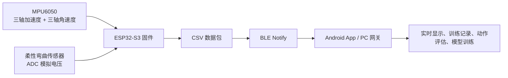
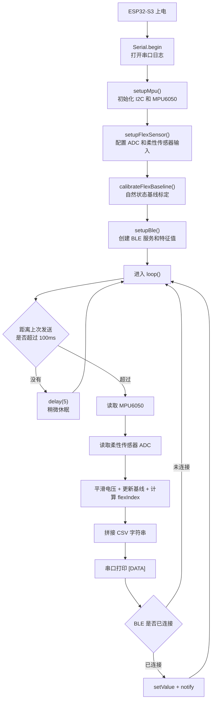
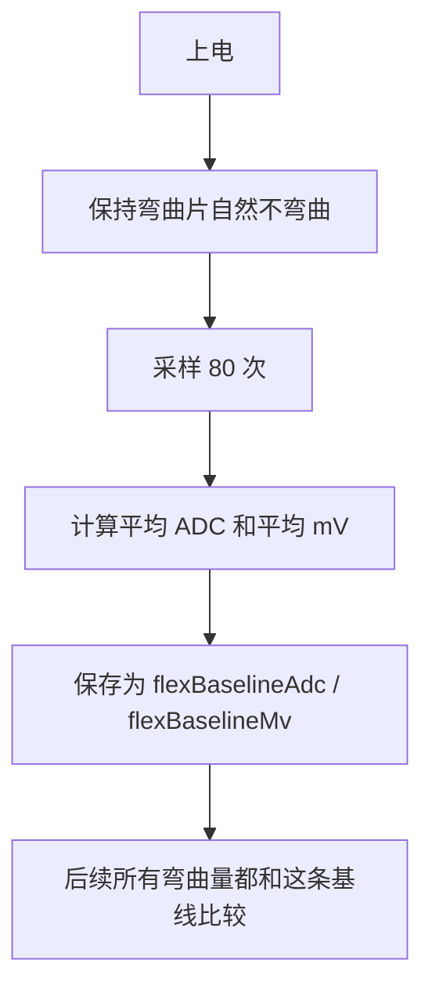
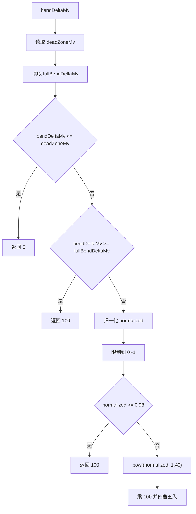
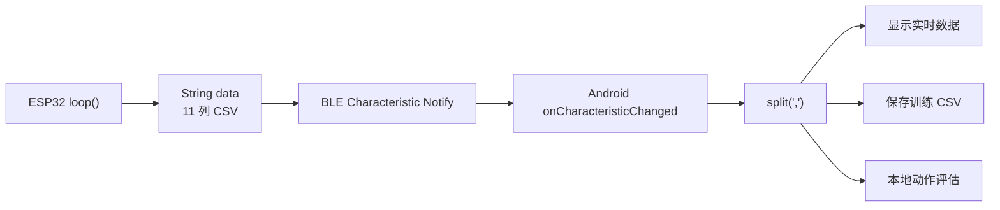

# ESP32-S3 Arduino 固件代码详细讲解

本文档用于帮助你从零理解本项目的 ESP32-S3 固件代码，也就是下面这个文件：

`ESPS3/ESPS3.ino`

这个 `.ino` 文件运行在 ESP32-S3 开发板上，负责读取 MPU6050 六轴 IMU 和柔性弯曲传感器，然后通过 BLE Notify 把数据实时发送给 Android 手机 App 或电脑网关。

如果把整个项目看成一条数据链路，那么 ESP32-S3 是最前端的“传感器采集节点”：



一句话概括：

> ESP32-S3 固件的核心任务是：定时采样传感器，把原始数据和弯曲指数整理成 CSV 字符串，再通过 BLE 广播给上位端。

## 1. 先看文件位置和运行方式

固件源码路径：

```text
ESPS3/ESPS3.ino
```

项目里还有一个编译脚本：

```text
tools/compile-esp32.ps1
```

这个脚本默认会编译 `ESPS3` 目录下的 Arduino 草图，目标开发板是：

```text
esp32:esp32:esp32s3
```

也就是说，它默认面向 ESP32-S3 Arduino Core。

编译命令是：

```powershell
.\tools\compile-esp32.ps1
```

如果想清理旧编译缓存再编译，可以使用：

```powershell
.\tools\compile-esp32.ps1 -Clean
```

## 2. 固件整体流程

Arduino 程序有两个最重要的函数：

```cpp
void setup()
void loop()
```

`setup()` 只在开发板上电或复位后执行一次，用于初始化硬件。

`loop()` 会一直重复执行，用于持续采集和发送数据。

本项目的运行流程可以画成这样：



你可以把它理解成一个每 100ms 工作一次的小循环：

1. 看时间到了没有。
2. 时间到了就采样一次。
3. 采样后算出弯曲指数。
4. 拼成一行 CSV。
5. 如果手机已经连上，就通过 BLE 发出去。

`BLE_SEND_INTERVAL_MS = 100`，所以理论发送频率是每秒 10 次。

## 3. 引入的库分别做什么

文件开头是这些 `#include`：

```cpp
#include <Arduino.h>
#include <Wire.h>
#include <math.h>
#include <MPU6050.h>
#include <BLEDevice.h>
#include <BLEUtils.h>
#include <BLEServer.h>
#include <BLE2902.h>
```

逐个解释：

| 库 | 作用 |
| --- | --- |
| `Arduino.h` | Arduino 基础库，提供 `setup()`、`loop()`、`pinMode()`、`analogRead()`、`millis()`、`delay()`、`Serial` 等基础能力。 |
| `Wire.h` | I2C 通信库，MPU6050 是通过 I2C 总线连接 ESP32-S3 的。 |
| `math.h` | 数学函数库，这里主要用 `powf()` 做弯曲指数曲线变换。 |
| `MPU6050.h` | MPU6050 传感器驱动库，用来读取加速度和角速度。 |
| `BLEDevice.h` | ESP32 BLE 基础入口，用来初始化 BLE 设备名、启动广播。 |
| `BLEUtils.h` | BLE 辅助工具。 |
| `BLEServer.h` | 创建 BLE GATT Server，也就是让手机作为客户端来连接 ESP32。 |
| `BLE2902.h` | 创建 CCCD 描述符，让手机可以订阅 Notify。 |

这里有个关键概念：

> ESP32-S3 在本项目里是 BLE 外设 Peripheral / GATT Server，Android 手机是 BLE 中心设备 Central / GATT Client。

也就是说，ESP32 负责广播“我在这里”，手机负责扫描、连接、订阅数据。

## 4. 传感器对象

```cpp
MPU6050 mpu;
```

这行创建了一个 MPU6050 对象。

后面会通过它调用：

```cpp
mpu.initialize();
mpu.testConnection();
mpu.getAcceleration(&ax, &ay, &az);
mpu.getRotation(&gx, &gy, &gz);
```

这些调用分别负责：

| 调用 | 含义 |
| --- | --- |
| `initialize()` | 初始化 MPU6050 芯片。 |
| `testConnection()` | 检查 I2C 是否能连上 MPU6050。 |
| `getAcceleration()` | 读取三轴加速度。 |
| `getRotation()` | 读取三轴角速度。 |

MPU6050 会输出六个核心值：

```text
ax, ay, az, gx, gy, gz
```

其中：

| 字段 | 含义 |
| --- | --- |
| `ax` | X 轴加速度原始值 |
| `ay` | Y 轴加速度原始值 |
| `az` | Z 轴加速度原始值 |
| `gx` | X 轴角速度原始值 |
| `gy` | Y 轴角速度原始值 |
| `gz` | Z 轴角速度原始值 |

注意：这里发送的是 MPU6050 的原始整数值，不是在固件里换算成 `g` 或 `deg/s` 后再发送。这样做的好处是上位端或机器学习流程可以保留更完整的原始信息。

## 5. BLE 相关常量

```cpp
static const char *DEVICE_NAME = "ESP32S3_Fitness_BLE";
static const char *SERVICE_UUID = "4fafc201-1fb5-459e-8fcc-c5c9c331914b";
static const char *CHARACTERISTIC_UUID = "beb5483e-36e1-4688-b7f5-ea07361b26a8";
static const uint16_t BLE_SEND_INTERVAL_MS = 100;
```

这几行决定了手机怎么找到 ESP32，并怎么订阅数据。

### 5.1 `DEVICE_NAME`

```cpp
"ESP32S3_Fitness_BLE"
```

这是蓝牙广播名称。

Android App 里扫描设备时，就是找这个名字。只要你改了固件里的 `DEVICE_NAME`，Android 端也要同步修改，否则手机就扫不到目标设备。

### 5.2 `SERVICE_UUID`

```cpp
"4fafc201-1fb5-459e-8fcc-c5c9c331914b"
```

这是 BLE 服务 UUID。

可以把 BLE 服务理解成一个功能模块。例如本项目只有一个主要服务：健身传感器数据服务。

Android 连接 ESP32 后，会在 GATT 服务列表里找这个 UUID。

### 5.3 `CHARACTERISTIC_UUID`

```cpp
"beb5483e-36e1-4688-b7f5-ea07361b26a8"
```

这是 BLE 特征值 UUID。

真正的数据就是通过这个 Characteristic 发出去的。

它支持两个属性：

```cpp
BLECharacteristic::PROPERTY_NOTIFY | BLECharacteristic::PROPERTY_READ
```

含义是：

| 属性 | 作用 |
| --- | --- |
| `PROPERTY_NOTIFY` | 允许 ESP32 主动向手机推送数据。 |
| `PROPERTY_READ` | 允许手机主动读取当前值。 |

本项目实时数据主要靠 Notify，不靠手机反复 Read。

### 5.4 `BLE_SEND_INTERVAL_MS`

```cpp
100
```

表示每 100ms 发送一次，也就是约 10Hz。

如果改成 `50`，理论上就是 20Hz；如果改成 `200`，理论上就是 5Hz。

但是不能只看发送频率，还要考虑 BLE 稳定性、手机处理速度、CSV 长度、功耗。当前 10Hz 对动作识别和毕业设计演示比较稳。

## 6. 硬件引脚配置

```cpp
static const int SDA_PIN = 1;
static const int SCL_PIN = 2;
static const int FLEX_SENSOR_PIN = 4;
```

这三行定义了传感器接线：

| 常量 | GPIO | 连接对象 |
| --- | --- | --- |
| `SDA_PIN` | GPIO1 | MPU6050 的 SDA |
| `SCL_PIN` | GPIO2 | MPU6050 的 SCL |
| `FLEX_SENSOR_PIN` | GPIO4 | 柔性弯曲传感器模块 AO 输出 |

MPU6050 使用 I2C，所以需要 SDA 和 SCL 两根信号线。

柔性弯曲传感器模块输出的是模拟电压，所以接到 ESP32-S3 的 ADC 引脚，也就是 GPIO4。

特别注意：

> ESP32-S3 的 ADC 引脚不能直接承受 5V。

代码注释里已经写得很明确：

如果弯曲传感器模块用 5V 供电，而模块 OUT 最高可能到 5V，就必须先做分压或限幅，保证 GPIO4 实际输入不超过 3.3V。

这不是软件问题，是硬件安全问题。如果 5V 直接进 ADC，引脚可能损坏。

## 7. ADC 和电压换算常量

```cpp
static const int ADC_RESOLUTION = 4095;
static const int ADC_REF_MV = 3300;
```

ESP32-S3 这里使用 12 位 ADC。

12 位 ADC 的取值范围是：

```text
0 ~ 4095
```

其中：

| ADC 值 | 近似电压 |
| --- | --- |
| `0` | 0mV |
| `2048` | 约 1650mV |
| `4095` | 约 3300mV |

代码里的换算公式是：

```cpp
long rawMv = ((long)rawAdc * ADC_REF_MV + ADC_RESOLUTION / 2) / ADC_RESOLUTION;
```

等价理解是：

```text
电压 mV = ADC 原始值 / 4095 * 3300
```

中间加上 `ADC_RESOLUTION / 2` 是为了做四舍五入，而不是单纯向下取整。

例如：

```text
rawAdc = 2048
rawMv ≈ 2048 / 4095 * 3300 ≈ 1650mV
```

## 8. 柔性传感器为什么要做基线标定

代码里有一段很重要的说明：

这个模块不是一个固定输出范围的标准传感器，而是“应变片 + 放大板 + 电位器”的结构。

这意味着：

1. 电位器位置不同，自然状态电压不同。
2. 安装松紧不同，自然状态电压不同。
3. 供电和温度不同，输出也可能漂移。
4. 同一个人重新绑一次，基线也可能变化。

所以代码没有写死“多少 mV 算弯曲”，而是上电时先测自然状态，把它作为基线。

流程是：



这就是 `calibrateFlexBaseline()` 的作用。

## 9. 柔性传感器方向常量

```cpp
static const bool FLEX_BEND_LOWERS_VOLTAGE = true;
```

这行表示当前安装方向下：

> 越弯曲，输出电压越低。

所以弯曲量计算时用的是：

```cpp
baselineMv - filteredMv
```

如果以后你把应变片翻面安装，出现“越弯曲，电压越高”，就把它改成：

```cpp
static const bool FLEX_BEND_LOWERS_VOLTAGE = false;
```

这样弯曲量就会改成：

```cpp
filteredMv - baselineMv
```

这就是为什么代码没有直接写死一个方向，而是留了一个布尔开关。

## 10. 上电基线标定参数

```cpp
static const int FLEX_BASELINE_SAMPLE_COUNT = 80;
static const int FLEX_BASELINE_SAMPLE_DELAY_MS = 10;
```

这表示上电标定时：

1. 采样 80 次。
2. 每次之间延迟 10ms。

所以总标定时间大约是：

```text
80 * 10ms = 800ms
```

再加上读取函数内部的一点微秒级延迟，实际接近 1 秒。

这就是为什么你上电后应该保持弯曲传感器自然状态大约 1 到 2 秒。

如果上电时你已经把传感器弯了，固件会把“弯曲状态”当成自然基线，后面的 `flexIndex` 就会不准。

## 11. ADC 去噪参数

```cpp
static const int FLEX_ADC_SAMPLE_COUNT = 9;
```

每次读取柔性传感器时，并不是只 `analogRead()` 一次，而是连续读取 9 次。

然后把这 9 个值排序，取中间 5 个求平均。

这样做叫“去极值后的中值均值”，目的是减少模拟信号抖动。

假设 9 次 ADC 读数是：

```text
2100, 2098, 2103, 3000, 2099, 2101, 1800, 2102, 2100
```

这里 `3000` 和 `1800` 可能是瞬间干扰。

排序后：

```text
1800, 2098, 2099, 2100, 2100, 2101, 2102, 2103, 3000
```

代码取第 2 到第 6 个下标，也就是中间 5 个：

```text
2099, 2100, 2100, 2101, 2102
```

这样就把异常高值和异常低值排除了。

对应代码在 `readFlexVoltageMv()`：

```cpp
for (int i = 0; i < FLEX_ADC_SAMPLE_COUNT; ++i) {
    samples[i] = analogRead(pin);
    delayMicroseconds(800);
}
```

然后排序：

```cpp
for (int i = 0; i < FLEX_ADC_SAMPLE_COUNT - 1; ++i) {
    for (int j = i + 1; j < FLEX_ADC_SAMPLE_COUNT; ++j) {
        if (samples[j] < samples[i]) {
            int temp = samples[i];
            samples[i] = samples[j];
            samples[j] = temp;
        }
    }
}
```

最后取中间 5 个：

```cpp
long middleSum = 0;
for (int i = 2; i <= 6; ++i) {
    middleSum += samples[i];
}

rawAdc = (int)(middleSum / 5);
```

## 12. 死区参数

```cpp
static const float FLEX_DEAD_ZONE_RATIO = 0.02f;
static const int FLEX_DEAD_ZONE_MIN_MV = 80;
static const int FLEX_DEAD_ZONE_MAX_MV = 220;
```

死区的意思是：

> 很小的电压变化不认为是有效弯曲。

为什么需要死区？

因为柔性传感器是模拟量，会有噪声。即使你不动，它也可能在几十 mV 内上下跳动。

如果没有死区，`flexIndex` 可能在自然状态下也一直跳，比如 0、1、3、2、0。

当前死区按基线的 2% 计算：

```text
deadZoneMv = baselineMv * 0.02
```

然后限制在 80mV 到 220mV 之间。

也就是说：

```cpp
return constrain(deadZoneMv, FLEX_DEAD_ZONE_MIN_MV, FLEX_DEAD_ZONE_MAX_MV);
```

举个例子：

如果自然状态基线是 2500mV：

```text
2500 * 0.02 = 50mV
```

但最小死区是 80mV，所以最终死区是：

```text
80mV
```

如果自然状态基线是 12000mV 这种不可能值，算出来会很大，但又会被最大值限制住。对本项目正常 0 到 3300mV 来说，主要是防止死区太小。

## 13. 满弯曲阈值参数

```cpp
static const float FLEX_FULL_BEND_RATIO = 1.00f;
static const int FLEX_FULL_BEND_MIN_MV = 1000;
static const int FLEX_FULL_BEND_MAX_MV = 3300;
```

这个参数决定“电压变化多少算 100% 弯曲”。

代码不是固定写成 2000mV，而是按当前基线计算：

```text
fullBendDeltaMv = baselineMv * 1.00
```

再限制在 1000mV 到 3300mV 之间。

例如基线是 2400mV：

```text
fullBendDeltaMv = 2400mV
```

如果传感器越弯电压越低，那么：

| 当前滤波电压 | 弯曲变化量 | flexIndex 大概趋势 |
| --- | --- | --- |
| 2400mV | 0mV | 0 |
| 2200mV | 200mV | 小 |
| 1600mV | 800mV | 中 |
| 500mV | 1900mV | 大 |
| 0mV | 2400mV | 接近 100 |

这个设计适合带电位器的模块，因为你调了电位器后，软件仍然可以基于新的自然状态自动计算阈值。

## 14. 平滑和基线跟踪参数

```cpp
static const float FLEX_SIGNAL_SMOOTH_ALPHA = 0.20f;
static const float FLEX_BASELINE_TRACK_ALPHA = 0.003f;
```

这两个参数都和“稳定显示”有关，但作用不一样。

### 14.1 信号平滑

`FLEX_SIGNAL_SMOOTH_ALPHA = 0.20f` 用在当前电压上：

```cpp
smoothedFlexMv = smoothedFlexMv +
                 ((float)rawVoltageMv - smoothedFlexMv) * FLEX_SIGNAL_SMOOTH_ALPHA;
```

这是一个一阶低通滤波，也可以理解成“新值占 20%，旧值保留 80%”。

如果当前平滑电压是 2000mV，新读数是 1800mV：

```text
smoothed = 2000 + (1800 - 2000) * 0.20
         = 2000 - 40
         = 1960mV
```

它不会一下从 2000 跳到 1800，而是慢慢靠近。

好处是 UI 和 `flexIndex` 不会抖得太厉害。

代价是响应会稍微慢一点。

### 14.2 基线跟踪

`FLEX_BASELINE_TRACK_ALPHA = 0.003f` 用在自然状态附近：

```cpp
flexBaselineMv = flexBaselineMv +
                 ((float)filteredMv - flexBaselineMv) * FLEX_BASELINE_TRACK_ALPHA;
```

它的作用是慢慢修正自然状态基线。

为什么需要它？

因为传感器可能有温漂、零点漂移、绑带压力变化。比如刚开机自然状态是 2500mV，过 10 分钟自然状态慢慢变成 2450mV。如果基线完全不动，系统会误以为你一直有轻微弯曲。

但是基线跟踪必须非常慢，并且只能在“接近自然状态”时进行。

所以 `updateFlexBaseline()` 里先判断：

```cpp
int baselineTrackWindowMv = getFlexDeadZoneMv() / 2;
if (bendDeltaMv > baselineTrackWindowMv) {
    return;
}
```

含义是：

> 如果当前看起来已经明显弯曲，就不要更新基线，避免把动作状态误当成自然状态。

## 15. 弯曲指数曲线参数

```cpp
static const float FLEX_INDEX_GAMMA = 1.40f;
```

这个参数控制 `flexIndex` 的曲线形状。

如果不用曲线，弯曲指数可以简单线性计算：

```text
flexIndex = normalized * 100
```

但有些柔性传感器在轻微弯曲时变化很明显，容易“微微一弯就数值很高”。

所以代码用了：

```cpp
float curved = powf(normalized, FLEX_INDEX_GAMMA);
```

当 `FLEX_INDEX_GAMMA > 1` 时，中前段会被压低。

例如：

| normalized | 线性结果 | gamma=1.4 后 |
| --- | --- | --- |
| 0.1 | 10 | 约 4 |
| 0.3 | 30 | 约 19 |
| 0.5 | 50 | 约 38 |
| 0.8 | 80 | 约 73 |
| 1.0 | 100 | 100 |

这样可以让 `flexIndex` 在轻微弯曲时更稳，不会太快冲到高分。

## 16. 近地轨报警参数

```cpp
static const int FLEX_NEAR_RAIL_MV = 80;
static const uint32_t FLEX_WARN_INTERVAL_MS = 3000;
```

如果柔性传感器原始电压长期接近 0mV，代码会在串口里报警：

```text
[FLEX][WARN] Raw voltage is near 0mV.
```

这通常说明：

1. 模块放大倍数太高。
2. 电位器零点没有调好。
3. AO 输出已经贴近下限。

为什么要隔 3000ms 才提醒一次？

因为 `loop()` 每 100ms 执行一次，如果每次都打印报警，串口会被刷屏，真正的数据反而不好看。

所以 `warnIfFlexOutputNearRail()` 使用 `lastFlexWarnMs` 控制提醒频率。

## 17. 全局运行状态变量

```cpp
BLECharacteristic *pCharacteristic = nullptr;
bool deviceConnected = false;
uint32_t packetSequence = 0;
bool mpuReady = false;

int flexBaselineAdc = 0;
float flexBaselineMv = 0.0f;
float smoothedFlexMv = 0.0f;
uint32_t lastFlexWarnMs = 0;
```

逐个解释：

| 变量 | 作用 |
| --- | --- |
| `pCharacteristic` | 指向 BLE 特征值对象，后续发送数据时要调用它的 `setValue()` 和 `notify()`。 |
| `deviceConnected` | 当前是否有手机或电脑网关连接。 |
| `packetSequence` | 数据包序号，每发一行 CSV 就加 1。 |
| `mpuReady` | MPU6050 是否初始化成功。失败时 IMU 数据用 0 填充。 |
| `flexBaselineAdc` | 上电自然状态 ADC 基线。 |
| `flexBaselineMv` | 上电自然状态电压基线，后续还会慢速跟踪。 |
| `smoothedFlexMv` | 平滑后的柔性传感器电压。 |
| `lastFlexWarnMs` | 上一次输出柔性传感器报警的时间。 |

这些变量是全局的，因为多个函数都要访问它们。

例如：

1. `setupBle()` 会创建 `pCharacteristic`。
2. `loop()` 会用 `pCharacteristic` 发送数据。
3. BLE 回调会修改 `deviceConnected`。
4. `loop()` 会判断 `deviceConnected` 决定要不要 Notify。
5. `calibrateFlexBaseline()` 初始化 `flexBaselineMv`。
6. `calculateBendDeltaMv()`、`updateFlexBaseline()`、`calculateFlexIndex()` 都依赖基线。

## 18. BLE 连接回调类

```cpp
class MyServerCallbacks : public BLEServerCallbacks {
public:
    void onConnect(BLEServer *pServer) override {
        deviceConnected = true;
        Serial.println("[BLE] Phone connected");
    }

    void onDisconnect(BLEServer *pServer) override {
        deviceConnected = false;
        pServer->getAdvertising()->start();
        Serial.println("[BLE] Phone disconnected");
        Serial.println("[BLE] Advertising restarted");
    }
};
```

这个类处理手机连接和断开事件。

### 18.1 手机连接时

```cpp
deviceConnected = true;
```

后面的 `loop()` 看到 `deviceConnected == true`，就会执行：

```cpp
pCharacteristic->setValue(data.c_str());
pCharacteristic->notify();
```

也就是开始给手机推送数据。

### 18.2 手机断开时

```cpp
deviceConnected = false;
pServer->getAdvertising()->start();
```

断开后要重新启动广播。

这是很重要的一行。如果不重新广播，手机断开后可能就再也扫不到这个 ESP32 设备，除非重启开发板。

所以这段代码保证了：

> 手机断开连接后，ESP32 会继续出现在蓝牙扫描列表里，方便再次连接。

## 19. 动态阈值函数

代码中有三个小函数专门计算当前柔性传感器阈值：

```cpp
int getCurrentBaselineMv()
int getFlexDeadZoneMv()
int getFlexFullBendDeltaMv()
```

### 19.1 `getCurrentBaselineMv()`

```cpp
int getCurrentBaselineMv() {
    return (int)(flexBaselineMv + 0.5f);
}
```

`flexBaselineMv` 是 `float`，为了显示和整数计算方便，这里转成 `int`。

加 `0.5f` 是为了四舍五入。

比如：

```text
2499.2 -> 2499
2499.7 -> 2500
```

### 19.2 `getFlexDeadZoneMv()`

```cpp
int getFlexDeadZoneMv() {
    int deadZoneMv = (int)(getCurrentBaselineMv() * FLEX_DEAD_ZONE_RATIO + 0.5f);
    return constrain(deadZoneMv, FLEX_DEAD_ZONE_MIN_MV, FLEX_DEAD_ZONE_MAX_MV);
}
```

作用是根据当前基线计算死区。

公式：

```text
死区 = 当前基线电压 * 2%
```

然后限制在 80mV 到 220mV。

这样做比写死一个固定死区更适合本项目硬件，因为弯曲模块带电位器，基线会变化。

### 19.3 `getFlexFullBendDeltaMv()`

```cpp
int getFlexFullBendDeltaMv() {
    int fullBendDeltaMv = (int)(getCurrentBaselineMv() * FLEX_FULL_BEND_RATIO + 0.5f);
    return constrain(fullBendDeltaMv, FLEX_FULL_BEND_MIN_MV, FLEX_FULL_BEND_MAX_MV);
}
```

作用是计算“多少电压变化量算满弯曲”。

当前比例是 100%，也就是约等于基线本身。

再限制在 1000mV 到 3300mV。

这个值越小，`flexIndex` 越容易到 100。

这个值越大，`flexIndex` 越不容易到 100。

## 20. I2C 扫描函数

```cpp
void scanI2cDevices() {
    Serial.println("[I2C] Scanning devices...");
    int found = 0;
    for (uint8_t address = 1; address < 127; ++address) {
        Wire.beginTransmission(address);
        if (Wire.endTransmission() == 0) {
            Serial.printf("[I2C] Found device at 0x%02X\n", address);
            found++;
        }
    }
    if (found == 0) {
        Serial.println("[I2C] No device found on the bus");
    }
}
```

这个函数会扫描 I2C 总线上的所有地址。

I2C 地址范围通常是 `0x01` 到 `0x7E`，所以代码循环：

```cpp
for (uint8_t address = 1; address < 127; ++address)
```

每个地址都尝试：

```cpp
Wire.beginTransmission(address);
Wire.endTransmission()
```

如果返回 0，说明这个地址有设备响应。

MPU6050 常见地址是：

```text
0x68
```

也有可能是：

```text
0x69
```

取决于 AD0 引脚接法。

所以如果串口能看到：

```text
[I2C] Found device at 0x68
```

基本说明 MPU6050 接线至少在 I2C 层面是通的。

如果看到：

```text
[I2C] No device found on the bus
```

就优先检查：

1. SDA 是否接到 GPIO1。
2. SCL 是否接到 GPIO2。
3. VCC 和 GND 是否接好。
4. MPU6050 供电电压是否正确。
5. 杜邦线是否松动。

## 21. 柔性传感器读取函数

函数定义：

```cpp
int readFlexVoltageMv(int pin, int &rawAdc)
```

它有两个输出：

1. 通过返回值返回电压 `mV`。
2. 通过引用参数 `rawAdc` 返回 ADC 原始值。

调用方式：

```cpp
int rawAdc = 0;
int rawVoltageMv = readFlexVoltageMv(FLEX_SENSOR_PIN, rawAdc);
```

执行完后：

| 变量 | 内容 |
| --- | --- |
| `rawAdc` | 原始 ADC 数值，范围约 0 到 4095。 |
| `rawVoltageMv` | 换算后的毫伏值，范围约 0 到 3300。 |

### 21.1 为什么 `rawAdc` 用引用参数

函数声明里：

```cpp
int &rawAdc
```

表示传进来的不是普通拷贝，而是外部变量本身。

所以函数内部写：

```cpp
rawAdc = (int)(middleSum / 5);
```

外面的 `rawAdc` 也会被改掉。

这样一个函数就能同时返回两个结果：

1. `return` 返回电压。
2. `rawAdc` 引用返回原始 ADC。

### 21.2 为什么采样之间有 `delayMicroseconds(800)`

```cpp
delayMicroseconds(800);
```

这是为了让连续 ADC 采样之间稍微隔开一点。

如果完全连续读取，某些 ADC 噪声或前一次采样影响可能更明显。这里 800 微秒很短，对 100ms 的主循环影响很小。

9 次采样一共大约：

```text
9 * 800us = 7200us = 7.2ms
```

加上排序和计算，仍然远小于 100ms 发送周期。

### 21.3 为什么发送原始值，而指数用平滑值

在 `loop()` 里有一句注释：

```cpp
// 指数内部使用平滑后的电压，原始值仍然按真实采样值发送给手机和 CSV。
```

意思是：

1. `flexIndex` 为了实时显示更稳定，使用平滑后的 `filteredVoltageMv`。
2. CSV 里仍然保存真实采样出来的 `rawAdc` 和 `rawVoltageMv`。

这样兼顾两个目标：

| 目标 | 使用数据 |
| --- | --- |
| 实时 UI 看起来稳定 | 平滑电压 |
| 后续建模保留真实细节 | 原始 ADC / 原始 mV |

这个设计很合理，因为机器学习训练通常希望保留尽量原始的数据，而 UI 指标则希望稳定易读。

## 22. 打印标定信息函数

```cpp
void printFlexCalibrationInfo() {
    Serial.printf("[FLEX] Baseline ADC = %d\n", flexBaselineAdc);
    Serial.printf("[FLEX] Baseline Voltage = %d mV\n", getCurrentBaselineMv());
    Serial.printf("[FLEX] Dead zone = %d mV\n", getFlexDeadZoneMv());
    Serial.printf("[FLEX] Full bend delta = %d mV\n", getFlexFullBendDeltaMv());
    Serial.printf("[FLEX] Signal smooth alpha = %.2f\n", FLEX_SIGNAL_SMOOTH_ALPHA);
    Serial.printf("[FLEX] Baseline track alpha = %.4f\n", FLEX_BASELINE_TRACK_ALPHA);
    Serial.printf("[FLEX] Index gamma = %.2f\n", FLEX_INDEX_GAMMA);
}
```

这个函数只负责把当前标定结果打印到串口。

上电后你可以通过串口监视器看到类似信息：

```text
[FLEX] Baseline ADC = 2780
[FLEX] Baseline Voltage = 2240 mV
[FLEX] Dead zone = 80 mV
[FLEX] Full bend delta = 2240 mV
[FLEX] Signal smooth alpha = 0.20
[FLEX] Baseline track alpha = 0.0030
[FLEX] Index gamma = 1.40
```

这些信息能帮你判断：

1. 自然状态电压是不是太低。
2. 死区是否合理。
3. 满弯曲阈值是否合理。
4. 当前滤波和指数参数是什么。

如果自然状态电压只有几十 mV，说明模块输出可能已经贴近下限，要调电位器或检查接线。

如果自然状态电压接近 3300mV，说明输出可能接近上限，也要注意是否会顶满。

## 23. 上电基线标定函数

```cpp
void calibrateFlexBaseline()
```

这是柔性传感器部分最关键的函数之一。

核心代码：

```cpp
for (int i = 0; i < FLEX_BASELINE_SAMPLE_COUNT; ++i) {
    int rawAdc = 0;
    int rawMv = readFlexVoltageMv(FLEX_SENSOR_PIN, rawAdc);
    adcSum += rawAdc;
    mvSum += rawMv;
    delay(FLEX_BASELINE_SAMPLE_DELAY_MS);
}

flexBaselineAdc = (int)(adcSum / FLEX_BASELINE_SAMPLE_COUNT);
flexBaselineMv = (float)mvSum / (float)FLEX_BASELINE_SAMPLE_COUNT;
smoothedFlexMv = flexBaselineMv;
```

它做了三件事：

1. 读取 80 次柔性传感器。
2. 计算平均 ADC 和平均电压。
3. 把平均电压作为自然状态基线。

其中：

```cpp
smoothedFlexMv = flexBaselineMv;
```

这句也很重要。

它让平滑电压的初始值等于自然状态基线。

如果不这样做，`smoothedFlexMv` 初始是 0，第一次循环会从 0 慢慢追到真实电压，导致刚启动时 `flexIndex` 异常。

标定前串口会提示：

```text
[FLEX] Keep the strain gauge in its natural, unbent state.
```

所以实际使用时，上电后不要立刻弯曲传感器，先让它保持自然状态。

## 24. 弯曲量计算函数

```cpp
int calculateBendDeltaMv(int filteredMv) {
    int baselineMv = getCurrentBaselineMv();
    int deltaMv = FLEX_BEND_LOWERS_VOLTAGE ? (baselineMv - filteredMv) : (filteredMv - baselineMv);
    return max(deltaMv, 0);
}
```

这个函数把“当前电压”和“自然基线”之间的差值转换成弯曲量。

如果当前安装方向是越弯曲电压越低：

```cpp
baselineMv - filteredMv
```

如果当前安装方向是越弯曲电压越高：

```cpp
filteredMv - baselineMv
```

最后：

```cpp
return max(deltaMv, 0);
```

表示弯曲量不能为负。

例如：

基线是 2500mV，越弯电压越低：

| 当前电压 | 计算结果 |
| --- | --- |
| 2500mV | 0mV |
| 2300mV | 200mV |
| 1800mV | 700mV |
| 2600mV | 0mV，因为负数被限制为 0 |

最后一行很重要。如果传感器因为噪声或反向轻微变化导致电压高于基线，代码不会给出负弯曲，而是直接当成 0。

## 25. 基线慢速跟踪函数

```cpp
void updateFlexBaseline(int filteredMv, int bendDeltaMv)
```

这个函数用于补偿自然状态漂移。

完整逻辑：

```cpp
int baselineTrackWindowMv = getFlexDeadZoneMv() / 2;
if (bendDeltaMv > baselineTrackWindowMv) {
    return;
}

flexBaselineMv = flexBaselineMv +
                 ((float)filteredMv - flexBaselineMv) * FLEX_BASELINE_TRACK_ALPHA;
```

可以分两步理解。

第一步，判断当前是否接近自然状态：

```cpp
int baselineTrackWindowMv = getFlexDeadZoneMv() / 2;
if (bendDeltaMv > baselineTrackWindowMv) {
    return;
}
```

如果当前弯曲量超过半个死区，说明它可能不是自然状态，就不要更新基线。

第二步，慢慢移动基线：

```cpp
flexBaselineMv = flexBaselineMv + (filteredMv - flexBaselineMv) * 0.003
```

假设当前基线是 2500mV，滤波电压是 2490mV：

```text
新基线 = 2500 + (2490 - 2500) * 0.003
       = 2500 - 0.03
       = 2499.97mV
```

变化非常慢。

这就是“跟踪漂移”，不是“立刻重标定”。

## 26. 弯曲指数计算函数

```cpp
int calculateFlexIndex(int bendDeltaMv)
```

这个函数把电压变化量转换成 0 到 100 的弯曲指数。

它的输入是：

```text
bendDeltaMv
```

输出是：

```text
flexIndex，范围 0 ~ 100
```

完整流程：



### 26.1 小于死区返回 0

```cpp
if (bendDeltaMv <= deadZoneMv || fullBendDeltaMv <= deadZoneMv) {
    return 0;
}
```

如果电压变化量还没超过死区，就认为没有有效弯曲。

`fullBendDeltaMv <= deadZoneMv` 是保护逻辑，防止阈值设置异常导致除法出错。

### 26.2 大于满弯曲阈值返回 100

```cpp
if (bendDeltaMv >= fullBendDeltaMv) {
    return 100;
}
```

如果变化量已经超过满弯曲阈值，就直接满分。

### 26.3 中间区间归一化

```cpp
float normalized = (float)(bendDeltaMv - deadZoneMv) /
                   (float)(fullBendDeltaMv - deadZoneMv);
```

假设：

```text
deadZoneMv = 100
fullBendDeltaMv = 2100
bendDeltaMv = 1100
```

那么：

```text
normalized = (1100 - 100) / (2100 - 100)
           = 1000 / 2000
           = 0.5
```

归一化后，0 表示刚过死区，1 表示达到满弯曲。

### 26.4 限制范围

```cpp
if (normalized < 0.0f) {
    normalized = 0.0f;
} else if (normalized > 1.0f) {
    normalized = 1.0f;
}
```

这是防御式写法，避免因为边界误差导致 normalized 超出 0 到 1。

### 26.5 接近满量程直接 100

```cpp
if (normalized >= 0.98f) {
    return 100;
}
```

当归一化值达到 98% 时直接返回 100。

这样用户在最大弯曲附近不需要刚好达到理论阈值，也能看到 100，体验更直观。

### 26.6 gamma 曲线

```cpp
float curved = powf(normalized, FLEX_INDEX_GAMMA);
return (int)(curved * 100.0f + 0.5f);
```

这里把线性值变成曲线值。

`+ 0.5f` 仍然是四舍五入。

例如 `curved * 100 = 37.6`，最终会变成 38。

## 27. 柔性传感器近 0mV 报警函数

```cpp
void warnIfFlexOutputNearRail(int rawMv)
```

完整逻辑：

```cpp
if (rawMv > FLEX_NEAR_RAIL_MV) {
    return;
}

if (millis() - lastFlexWarnMs < FLEX_WARN_INTERVAL_MS) {
    return;
}

lastFlexWarnMs = millis();
Serial.println("[FLEX][WARN] Raw voltage is near 0mV.");
```

这个函数有两个提前返回：

1. 如果电压高于 80mV，说明还没贴近 0，不报警。
2. 如果距离上一次报警不到 3 秒，不报警。

只有两个条件都通过，才打印报警。

这个报警是为了提醒硬件调试：

> 当前 AO 输出可能已经撞到下限，传感器变化空间变小，数据质量会受影响。

如果你看到这个报警，建议：

1. 调一下模块电位器。
2. 检查供电是否正确。
3. 确认传感器没有被压死或接反。
4. 用万用表测 AO 对 GND 电压。

## 28. BLE 初始化函数

```cpp
void setupBle()
```

这个函数负责创建 BLE 服务。

### 28.1 初始化 BLE 设备名

```cpp
BLEDevice::init(DEVICE_NAME);
```

这会让 ESP32 的 BLE 名称变成：

```text
ESP32S3_Fitness_BLE
```

手机扫描时会看到这个名字。

### 28.2 创建 BLE Server

```cpp
BLEServer *pServer = BLEDevice::createServer();
pServer->setCallbacks(new MyServerCallbacks());
```

ESP32 是 GATT Server。

设置回调后，手机连接和断开时就会进入 `MyServerCallbacks`。

### 28.3 创建 Service

```cpp
BLEService *pService = pServer->createService(SERVICE_UUID);
```

创建一个 BLE 服务，UUID 是前面定义的 `SERVICE_UUID`。

手机连接后会查找这个服务。

### 28.4 创建 Characteristic

```cpp
pCharacteristic = pService->createCharacteristic(
    CHARACTERISTIC_UUID,
    BLECharacteristic::PROPERTY_NOTIFY | BLECharacteristic::PROPERTY_READ
);
```

这就是数据出口。

`pCharacteristic` 被保存到全局变量里，后面的 `loop()` 会用它发送数据。

### 28.5 添加 BLE2902 描述符

```cpp
pCharacteristic->addDescriptor(new BLE2902());
```

BLE Notify 通常需要 CCCD，也就是 Client Characteristic Configuration Descriptor。

`BLE2902` 就是这个描述符。

Android 端订阅 Notify 时，会往这个描述符里写入启用通知的配置。

如果没有它，有些手机可能无法正常订阅通知。

### 28.6 设置初始值

```cpp
pCharacteristic->setValue("booting");
```

刚创建时先放一个 `"booting"`。

这不是实时传感器数据，只是初始占位值。真正数据在 `loop()` 里不断更新。

### 28.7 启动服务和广播

```cpp
pService->start();

BLEAdvertising *pAdvertising = BLEDevice::getAdvertising();
pAdvertising->addServiceUUID(SERVICE_UUID);
pAdvertising->setScanResponse(true);
pAdvertising->setMinPreferred(0x06);
pAdvertising->setMinPreferred(0x12);
BLEDevice::startAdvertising();
```

这里做了几件事：

1. 启动 GATT 服务。
2. 广播里带上服务 UUID。
3. 允许扫描响应。
4. 设置连接参数偏好。
5. 开始广播。

当手机扫描到设备后，就能看到它提供的服务 UUID，并发起连接。

## 29. MPU6050 初始化函数

```cpp
void setupMpu()
```

完整逻辑：

```cpp
Wire.begin(SDA_PIN, SCL_PIN);
scanI2cDevices();
mpu.initialize();

if (!mpu.testConnection()) {
    Serial.println("[MPU6050] Connection failed");
    ...
    mpuReady = false;
    return;
}

Serial.println("[MPU6050] Ready");
mpuReady = true;
```

### 29.1 初始化 I2C

```cpp
Wire.begin(SDA_PIN, SCL_PIN);
```

表示用 GPIO1 作为 SDA，GPIO2 作为 SCL。

如果你的实际接线不是这两个 GPIO，就必须改这里的常量。

### 29.2 扫描 I2C

```cpp
scanI2cDevices();
```

这个扫描主要是为了调试。

它不是读取数据所必需的，但对排查接线问题很有用。

### 29.3 初始化 MPU6050

```cpp
mpu.initialize();
```

驱动库会配置 MPU6050 的内部寄存器。

### 29.4 测试连接

```cpp
if (!mpu.testConnection()) {
    ...
    mpuReady = false;
    return;
}
```

如果连接失败，代码不会停止整个程序，而是让 `mpuReady = false`。

这样后面 BLE 仍然会启动，柔性传感器仍然可以工作。

在 `loop()` 里，如果 `mpuReady == false`：

```cpp
ax = ay = az = 0;
gx = gy = gz = 0;
```

也就是说，IMU 数据用 0 填充。

这个设计对调试很友好：

> 即使 MPU6050 没接好，手机也仍然能连上 ESP32，并看到柔性传感器数据。

## 30. 柔性传感器初始化函数

```cpp
void setupFlexSensor()
```

内容：

```cpp
analogReadResolution(12);
pinMode(FLEX_SENSOR_PIN, INPUT);

Serial.printf("[FLEX] GPIO %d ready\n", FLEX_SENSOR_PIN);
Serial.println("[FLEX] Module type: strain gauge amplifier AO output");
Serial.println("[FLEX] If the module is powered from 5V, do not connect OUT directly to ESP32-S3 ADC without voltage limiting.");
```

### 30.1 设置 ADC 分辨率

```cpp
analogReadResolution(12);
```

表示 ADC 读取结果是 12 位，也就是 0 到 4095。

这和前面的：

```cpp
ADC_RESOLUTION = 4095
```

是匹配的。

### 30.2 设置 GPIO 输入

```cpp
pinMode(FLEX_SENSOR_PIN, INPUT);
```

GPIO4 作为输入脚读取 AO 电压。

### 30.3 输出硬件安全提示

串口提示 5V 模块不能直接接 ESP32 ADC。

这是因为 ESP32 ADC 只能接 0 到 3.3V 范围内的模拟电压。

## 31. `setup()` 主初始化函数

```cpp
void setup() {
    Serial.begin(115200);
    delay(1000);

    Serial.println();
    Serial.println("=================================");
    Serial.println("ESP32-S3 Smart Fitness Node");
    Serial.println("IMU + Strain Gauge + BLE");
    Serial.println("=================================");

    setupMpu();
    setupFlexSensor();
    calibrateFlexBaseline();
    setupBle();
}
```

执行顺序非常重要。

### 31.1 串口初始化

```cpp
Serial.begin(115200);
delay(1000);
```

打开 115200 波特率的串口日志。

`delay(1000)` 给串口和开发板启动一点缓冲时间，方便你打开串口监视器时看到启动日志。

### 31.2 打印启动横幅

```cpp
Serial.println("ESP32-S3 Smart Fitness Node");
Serial.println("IMU + Strain Gauge + BLE");
```

这只是为了让串口输出更清晰，知道当前烧录的是这个项目的固件。

### 31.3 初始化顺序

```cpp
setupMpu();
setupFlexSensor();
calibrateFlexBaseline();
setupBle();
```

含义：

1. 先初始化 MPU6050。
2. 再配置柔性传感器 ADC。
3. 然后做柔性传感器自然状态标定。
4. 最后启动 BLE。

为什么 BLE 放最后？

因为上电标定需要你保持自然状态。如果 BLE 先启动，手机可能马上连上，但这时数据还没准备好。先完成传感器初始化和标定，再广播给手机，更符合实际使用流程。

## 32. `loop()` 主循环详解

`loop()` 是固件最核心的实时逻辑。

它会一直重复执行，但真正采样发送受 `BLE_SEND_INTERVAL_MS` 控制。

### 32.1 发送节流

```cpp
static uint32_t lastSendMs = 0;

if (millis() - lastSendMs < BLE_SEND_INTERVAL_MS) {
    delay(5);
    return;
}
lastSendMs = millis();
```

`millis()` 返回开发板从启动到现在经过的毫秒数。

这段代码的意思是：

> 如果距离上次发送还不到 100ms，就休息 5ms，然后退出本次 loop。

`static uint32_t lastSendMs = 0;` 的 `static` 很关键。

普通局部变量每次进入函数都会重新创建。

`static` 局部变量只初始化一次，后面会保留上次的值。

所以 `lastSendMs` 能记住上一次发送时间。

### 32.2 声明本次采样变量

```cpp
int16_t ax, ay, az;
int16_t gx, gy, gz;
int rawAdc = 0;
uint32_t timestampMs = millis();
```

这里准备保存本次采样的数据：

| 变量 | 作用 |
| --- | --- |
| `ax ay az` | 三轴加速度 |
| `gx gy gz` | 三轴角速度 |
| `rawAdc` | 柔性传感器 ADC 原始值 |
| `timestampMs` | 本次数据包时间戳 |

`timestampMs` 是 ESP32 自己的运行毫秒数，不是手机时间，也不是北京时间。

它适合用来分析采样间隔和动作相对时间。

### 32.3 读取 MPU6050

```cpp
if (mpuReady) {
    mpu.getAcceleration(&ax, &ay, &az);
    mpu.getRotation(&gx, &gy, &gz);
} else {
    ax = ay = az = 0;
    gx = gy = gz = 0;
}
```

如果 MPU6050 初始化成功，就读取真实数据。

如果失败，就把六轴数据全部置零。

这里传给函数的是地址：

```cpp
&ax, &ay, &az
```

意思是让 `getAcceleration()` 直接把结果写进这几个变量。

### 32.4 读取柔性传感器原始电压

```cpp
int rawVoltageMv = readFlexVoltageMv(FLEX_SENSOR_PIN, rawAdc);
```

执行后得到：

| 数据 | 保存位置 |
| --- | --- |
| ADC 原始值 | `rawAdc` |
| 原始电压 mV | `rawVoltageMv` |

这两个值都会进入最终 CSV。

### 32.5 平滑电压

```cpp
smoothedFlexMv = smoothedFlexMv +
                 ((float)rawVoltageMv - smoothedFlexMv) * FLEX_SIGNAL_SMOOTH_ALPHA;
int filteredVoltageMv = (int)(smoothedFlexMv + 0.5f);
```

这里生成 `filteredVoltageMv`，后面用它计算 `flexIndex`。

注意：

> `filteredVoltageMv` 不进入 CSV，CSV 保存的是原始 `rawVoltageMv`。

这样既能让指数稳定，又能保留原始数据。

### 32.6 计算弯曲量并更新基线

```cpp
int bendDeltaMv = calculateBendDeltaMv(filteredVoltageMv);
updateFlexBaseline(filteredVoltageMv, bendDeltaMv);
bendDeltaMv = calculateBendDeltaMv(filteredVoltageMv);
```

这里为什么计算了两次 `bendDeltaMv`？

第一遍：

```cpp
int bendDeltaMv = calculateBendDeltaMv(filteredVoltageMv);
```

用旧基线计算当前弯曲量，判断是否接近自然状态。

然后：

```cpp
updateFlexBaseline(filteredVoltageMv, bendDeltaMv);
```

如果接近自然状态，就可能轻微更新基线。

最后：

```cpp
bendDeltaMv = calculateBendDeltaMv(filteredVoltageMv);
```

基线可能已经被更新，所以重新计算一次弯曲量，保证后面的 `flexIndex` 使用最新基线。

这是一个小细节，但很严谨。

### 32.7 计算弯曲指数

```cpp
int flexIndex = calculateFlexIndex(bendDeltaMv);
```

最终得到 0 到 100 的 `flexIndex`。

Android App 里会显示这个值，并用它做本地动作评估。

### 32.8 检查传感器是否贴近 0mV

```cpp
warnIfFlexOutputNearRail(rawVoltageMv);
```

如果原始电压太低，会每隔 3 秒输出一次报警。

### 32.9 拼接 CSV 数据

```cpp
String data = String(packetSequence++) + "," + String(timestampMs) + "," +
              String(ax) + "," + String(ay) + "," + String(az) + "," +
              String(gx) + "," + String(gy) + "," + String(gz) + "," +
              String(rawAdc) + "," + String(rawVoltageMv) + "," + String(flexIndex);
```

这是最终发送给手机的数据。

CSV 格式是：

```text
seq,timestampMs,ax,ay,az,gx,gy,gz,flexRawAdc,flexRawMv,flexIndex
```

一共 11 列。

每列含义：

| 序号 | 字段 | 含义 | 示例 |
| --- | --- | --- | --- |
| 1 | `seq` | 数据包序号，每包加 1 | `0`、`1`、`2` |
| 2 | `timestampMs` | ESP32 启动后的毫秒数 | `123456` |
| 3 | `ax` | X 轴加速度原始值 | `-1200` |
| 4 | `ay` | Y 轴加速度原始值 | `300` |
| 5 | `az` | Z 轴加速度原始值 | `16000` |
| 6 | `gx` | X 轴角速度原始值 | `40` |
| 7 | `gy` | Y 轴角速度原始值 | `-80` |
| 8 | `gz` | Z 轴角速度原始值 | `12` |
| 9 | `flexRawAdc` | 柔性传感器 ADC 原始值 | `2780` |
| 10 | `flexRawMv` | 柔性传感器原始电压 mV | `2240` |
| 11 | `flexIndex` | 弯曲指数 0 到 100 | `37` |

示例数据可能长这样：

```text
128,14352,-824,312,16120,25,-60,8,2780,2240,0
129,14452,-910,420,15880,80,-120,30,2500,2015,12
130,14552,-1200,600,15400,200,-300,90,2100,1692,34
```

这个格式必须和 Android App、PC 网关保持一致。

如果你在固件里新增字段，例如加一个温度 `temperature`，那么 Android 和 PC 网关的 CSV 解析代码也要同步修改。

### 32.10 串口打印数据

```cpp
Serial.print("[DATA] ");
Serial.println(data);
```

串口会输出完整 CSV，前面带 `[DATA]` 前缀。

这样即使手机没有连接，也可以通过串口监视器看到传感器是否工作。

### 32.11 BLE Notify 发送

```cpp
if (deviceConnected && pCharacteristic != nullptr) {
    pCharacteristic->setValue(data.c_str());
    pCharacteristic->notify();
}
```

只有满足两个条件才发送：

1. `deviceConnected == true`
2. `pCharacteristic != nullptr`

`data.c_str()` 把 Arduino `String` 转成 C 风格字符串。

`setValue()` 把特征值内容更新为本次 CSV。

`notify()` 主动通知手机：“有新数据了”。

Android 端收到 Notify 后，会进入自己的回调函数，解析 CSV 并更新界面。

## 33. CSV 协议和 Android App 的关系

固件输出的是：

```text
seq,timestampMs,ax,ay,az,gx,gy,gz,flexRawAdc,flexRawMv,flexIndex
```

Android App 需要按这个顺序解析。

对应关系可以理解为：



最容易出问题的是字段顺序。

例如固件发送：

```text
seq,timestampMs,ax,ay,az,gx,gy,gz,flexRawAdc,flexRawMv,flexIndex
```

Android 就必须按：

```text
0 -> seq
1 -> timestampMs
2 -> ax
3 -> ay
4 -> az
5 -> gx
6 -> gy
7 -> gz
8 -> flexRawAdc
9 -> flexRawMv
10 -> flexIndex
```

来读。

如果你把 `flexIndex` 提前到第 9 列，但 Android 还按旧格式读，就会出现数据错位。

所以协议修改要同时改：

1. ESP32 固件 CSV 拼接。
2. Android App CSV 解析。
3. PC 网关 CSV 解析。
4. 数据集预处理脚本。
5. 文档里的数据协议说明。

## 34. 为什么使用 BLE Notify，而不是 Wi-Fi 或串口

本项目选择 BLE Notify 有几个原因：

1. 手机可以直接连接 ESP32，不需要路由器。
2. BLE 功耗比 Wi-Fi 更低。
3. 10Hz 左右的传感器数据量不大，BLE 足够用。
4. Android 对 BLE GATT 支持成熟。
5. 毕设演示时手机连接更直观。

串口适合开发调试，但手机无法直接用串口收数据。

Wi-Fi 适合高吞吐或局域网服务，但需要配网、IP、热点或路由器，对演示环境要求更高。

所以这里 BLE 是比较稳的选择。

## 35. MPU6050 数据为什么不在固件里换算单位

MPU6050 原始值可以换算成实际单位，比如：

| 原始数据 | 可换算单位 |
| --- | --- |
| 加速度 | `g` 或 `m/s^2` |
| 角速度 | `deg/s` |

但是本固件直接发送原始整数。

原因主要有：

1. 原始数据保留更多处理自由度。
2. 机器学习模型不一定需要物理单位，只需要稳定特征。
3. 避免固件端做过多浮点计算。
4. 上位端 Python/Android 更容易调整算法。

如果以后要在手机界面显示物理单位，可以在 Android 或 PC 网关里换算。

## 36. 柔性传感器数据为什么同时发 `rawAdc`、`rawMv`、`flexIndex`

CSV 里柔性传感器有三列：

```text
flexRawAdc,flexRawMv,flexIndex
```

它们各自用途不同：

| 字段 | 作用 |
| --- | --- |
| `flexRawAdc` | 最原始的 ADC 数值，适合底层调试和建模。 |
| `flexRawMv` | 换算后的电压，适合理解硬件输出和调电位器。 |
| `flexIndex` | 0 到 100 的弯曲程度，适合 UI 显示和实时反馈。 |

如果只发 `flexIndex`，后面发现指数算法不合适，就无法从数据集重新计算。

如果保留 `rawAdc` 和 `rawMv`，后续可以重新设计 `flexIndex` 算法，而不用重新采集所有动作数据。

这对毕业设计的数据迭代很重要。

## 37. 常见修改点

### 37.1 修改 BLE 设备名

改这里：

```cpp
static const char *DEVICE_NAME = "ESP32S3_Fitness_BLE";
```

同时要改 Android App 中扫描目标设备名的地方。

### 37.2 修改发送频率

改这里：

```cpp
static const uint16_t BLE_SEND_INTERVAL_MS = 100;
```

推荐范围：

| 值 | 频率 | 说明 |
| --- | --- | --- |
| `200` | 5Hz | 更省电，更稳，但动作细节少。 |
| `100` | 10Hz | 当前配置，演示和训练比较平衡。 |
| `50` | 20Hz | 数据更密，但 BLE 压力更大。 |

### 37.3 修改 MPU6050 引脚

改这里：

```cpp
static const int SDA_PIN = 1;
static const int SCL_PIN = 2;
```

同时实际接线也要改。

### 37.4 修改柔性传感器 ADC 引脚

改这里：

```cpp
static const int FLEX_SENSOR_PIN = 4;
```

注意要选择支持 ADC 的 ESP32-S3 GPIO。

### 37.5 弯曲方向反了

如果越弯曲 `flexIndex` 反而越小，或者自然状态有高值、弯曲后变 0，先改这里：

```cpp
static const bool FLEX_BEND_LOWERS_VOLTAGE = true;
```

改成：

```cpp
static const bool FLEX_BEND_LOWERS_VOLTAGE = false;
```

### 37.6 自然状态下 `flexIndex` 抖动

可以适当增大死区：

```cpp
static const float FLEX_DEAD_ZONE_RATIO = 0.02f;
static const int FLEX_DEAD_ZONE_MIN_MV = 80;
```

例如把最小死区从 80 调到 100 或 120。

但不要调太大，否则轻微动作会被吞掉。

### 37.7 轻微弯曲就接近 100

可以调整两个地方：

1. 增大满弯曲阈值。
2. 增大 gamma。

相关常量：

```cpp
static const float FLEX_FULL_BEND_RATIO = 1.00f;
static const float FLEX_INDEX_GAMMA = 1.40f;
```

`FLEX_FULL_BEND_RATIO` 越大，越不容易满 100。

`FLEX_INDEX_GAMMA` 越大，中前段越不敏感。

### 37.8 数据太慢或动作细节不够

可以把发送间隔改小，例如：

```cpp
static const uint16_t BLE_SEND_INTERVAL_MS = 50;
```

但要观察手机是否丢包、是否卡顿。

### 37.9 串口一直提示 Raw voltage near 0mV

优先处理硬件：

1. 调低模块增益或调整零点。
2. 检查 AO 输出是否真的接到 GPIO4。
3. 确认 GND 共地。
4. 确认没有把模块 OUT 拉到地。
5. 确认没有把 5V 直接接到 ADC。

## 38. 常见故障排查

### 38.1 手机扫不到设备

检查：

1. 固件是否烧录成功。
2. 串口是否打印 `[BLE] Service started`。
3. Android 端扫描的设备名是否和 `DEVICE_NAME` 一致。
4. 手机蓝牙和定位权限是否开启。
5. ESP32 是否已经被另一台手机连接。

### 38.2 手机连接后没有数据

检查：

1. 串口是否每 100ms 打印 `[DATA]`。
2. Android 是否成功订阅 Notify。
3. `SERVICE_UUID` 和 `CHARACTERISTIC_UUID` 是否一致。
4. `pCharacteristic->notify()` 是否执行。
5. 手机端是否因为权限或回调问题没有进入数据处理逻辑。

### 38.3 MPU6050 数据全是 0

如果柔性传感器正常，但 `ax ay az gx gy gz` 全是 0，通常说明 `mpuReady == false`。

检查串口是否有：

```text
[MPU6050] Connection failed
```

再检查：

1. SDA/SCL 接线。
2. VCC/GND。
3. MPU6050 地址扫描结果。
4. 模块是否损坏。
5. 是否选错开发板或 GPIO。

### 38.4 柔性传感器数据不变化

检查：

1. AO 是否接到 GPIO4。
2. 是否接成了 DO 数字输出。
3. 模块是否供电。
4. GND 是否和 ESP32 共地。
5. 电位器是否调到极端导致输出贴边。
6. 传感器实际弯曲方向是否能让电压变化。

### 38.5 `flexIndex` 自然状态不是 0

可能原因：

1. 上电标定时传感器已经被弯曲。
2. 传感器安装压力变化很大。
3. 输出抖动超过死区。
4. 基线漂移太大。

处理方式：

1. 重启 ESP32，并保持自然状态 1 到 2 秒。
2. 增大死区。
3. 检查绑带固定是否稳定。
4. 调整模块电位器，让自然状态电压处于合理范围。

### 38.6 `flexIndex` 一直 100

可能原因：

1. 上电时传感器处于弯曲状态，导致基线错误。
2. 弯曲方向设置反了。
3. 模块输出贴近 0mV 或 3300mV。
4. 满弯曲阈值太小。

处理方式：

1. 自然状态重启标定。
2. 检查 `FLEX_BEND_LOWERS_VOLTAGE`。
3. 查看串口中的 Baseline Voltage。
4. 调整 `FLEX_FULL_BEND_RATIO`。

## 39. 和数据采集规范的关系

项目里的数据采集规范要求：

1. 传感器安装位置固定。
2. 每次上电后自然状态保持 1 到 2 秒。
3. 采集开始前后静止 2 秒。
4. BLE 距离保持 1 到 2 米。
5. 如果 BLE 掉包或传感器滑动，数据废弃。

这些要求和固件设计是配套的。

例如：

| 规范要求 | 固件原因 |
| --- | --- |
| 上电后保持自然状态 | `calibrateFlexBaseline()` 需要自然基线。 |
| 传感器位置固定 | 同一动作的数据分布才稳定。 |
| 开始前静止 2 秒 | 方便后期观察基线和动作起点。 |
| BLE 距离保持近 | 减少 Notify 丢包。 |
| 掉包数据废弃 | `seq` 可以帮助发现数据是否连续。 |

其中 `seq` 字段很有用。

如果 CSV 中序号从 100 跳到 110，说明中间可能丢了 9 包。

## 40. 推荐阅读顺序

如果你是第一次看这个 `.ino`，建议按下面顺序读：

1. 先读 `setup()`，知道系统启动时做了哪些初始化。
2. 再读 `loop()`，知道每 100ms 做了什么。
3. 然后读 `setupBle()`，理解手机为什么能连接。
4. 再读 `setupMpu()`，理解 MPU6050 的初始化和失败处理。
5. 再读 `setupFlexSensor()` 和 `calibrateFlexBaseline()`，理解柔性传感器的基线。
6. 然后读 `readFlexVoltageMv()`，理解 ADC 如何去噪和换算电压。
7. 最后读 `calculateBendDeltaMv()`、`updateFlexBaseline()`、`calculateFlexIndex()`，理解 `flexIndex` 如何算出来。

这样读会比从第一行硬啃更容易。

## 41. 用一句话总结每个函数

| 函数 / 类 | 一句话作用 |
| --- | --- |
| `MyServerCallbacks` | 处理 BLE 连接和断开，断开后重新广播。 |
| `getCurrentBaselineMv()` | 把当前柔性传感器基线转成整数 mV。 |
| `getFlexDeadZoneMv()` | 根据基线计算抗抖死区。 |
| `getFlexFullBendDeltaMv()` | 根据基线计算满弯曲阈值。 |
| `scanI2cDevices()` | 扫描 I2C 总线，帮助排查 MPU6050 接线。 |
| `readFlexVoltageMv()` | 多次读取 ADC、去极值、求平均、换算 mV。 |
| `printFlexCalibrationInfo()` | 打印柔性传感器标定结果和参数。 |
| `calibrateFlexBaseline()` | 上电时采样自然状态，建立弯曲基线。 |
| `calculateBendDeltaMv()` | 根据安装方向计算当前弯曲电压变化量。 |
| `updateFlexBaseline()` | 在自然状态附近慢速修正基线漂移。 |
| `calculateFlexIndex()` | 把弯曲变化量转换成 0 到 100 的指数。 |
| `warnIfFlexOutputNearRail()` | 检查柔性传感器输出是否贴近 0mV 并报警。 |
| `setupBle()` | 创建 BLE 设备、服务、特征值和广播。 |
| `setupMpu()` | 初始化 I2C 和 MPU6050。 |
| `setupFlexSensor()` | 设置 ADC 分辨率和柔性传感器输入脚。 |
| `setup()` | 系统启动初始化总入口。 |
| `loop()` | 定时读取传感器、拼接 CSV、通过 BLE 发送。 |

## 42. 最核心的三条主线

如果只记三个重点，就是这三条：

### 主线一：硬件初始化

```text
setup()
  -> setupMpu()
  -> setupFlexSensor()
  -> calibrateFlexBaseline()
  -> setupBle()
```

这条线负责让传感器和 BLE 能工作。

### 主线二：柔性传感器算法

```text
readFlexVoltageMv()
  -> smoothedFlexMv
  -> calculateBendDeltaMv()
  -> updateFlexBaseline()
  -> calculateFlexIndex()
```

这条线负责把模拟电压变成 `flexIndex`。

### 主线三：数据发送协议

```text
packetSequence + timestamp + IMU + flexRawAdc + flexRawMv + flexIndex
  -> String data
  -> Serial.println()
  -> BLE notify()
```

这条线负责把数据送给 Android 和 PC 网关。

## 43. 这份固件的设计优点

这份 `.ino` 代码虽然不长，但有几个设计点很适合毕业设计项目：

1. BLE 断开后自动重新广播，演示时不容易卡死。
2. MPU6050 失败不会导致整个程序停止，方便分模块调试。
3. 柔性传感器使用上电基线，不依赖固定电压阈值。
4. ADC 读取做了去极值均值，减少模拟噪声。
5. `flexIndex` 做了死区、平滑和 gamma 曲线，显示更稳定。
6. CSV 同时保留原始值和指数，后续建模更灵活。
7. 串口输出足够详细，硬件调试时有依据。

## 44. 这份固件的注意事项

使用时最容易踩的点也很明确：

1. 上电标定时必须保持自然不弯曲。
2. 如果弯曲方向反了，要改 `FLEX_BEND_LOWERS_VOLTAGE`。
3. 如果模块 5V 供电，不能让 5V 直接进入 ESP32 ADC。
4. CSV 字段顺序不要随便改，改了就要同步 Android、PC 网关和数据处理脚本。
5. BLE UUID 不要只改固件一端，手机端也要一起改。
6. 训练数据采集时传感器位置要固定，否则模型会学到混乱数据。

## 45. 最后用一句完整的话串起来

ESP32-S3 上电后先初始化串口、MPU6050、柔性传感器和 BLE；随后对柔性传感器做自然状态基线标定；进入主循环后，每隔 100ms 读取一次 MPU6050 六轴数据和柔性传感器 ADC 电压；固件对柔性传感器电压做平滑、基线跟踪、死区判断和 gamma 曲线映射，得到 0 到 100 的 `flexIndex`；最后把 `seq,timestampMs,ax,ay,az,gx,gy,gz,flexRawAdc,flexRawMv,flexIndex` 拼成 CSV，通过串口打印并通过 BLE Notify 发送给 Android App 或 PC 网关。

